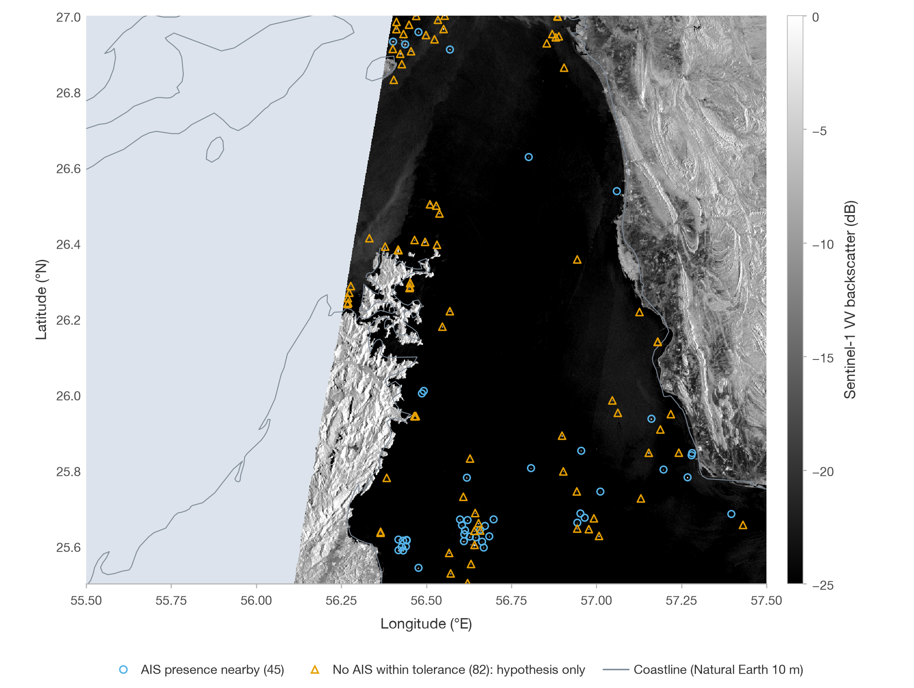
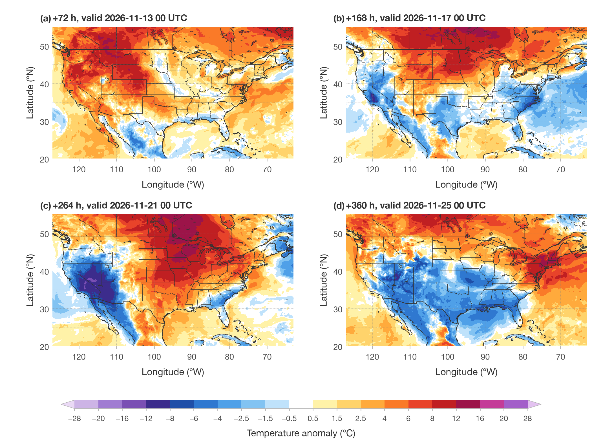
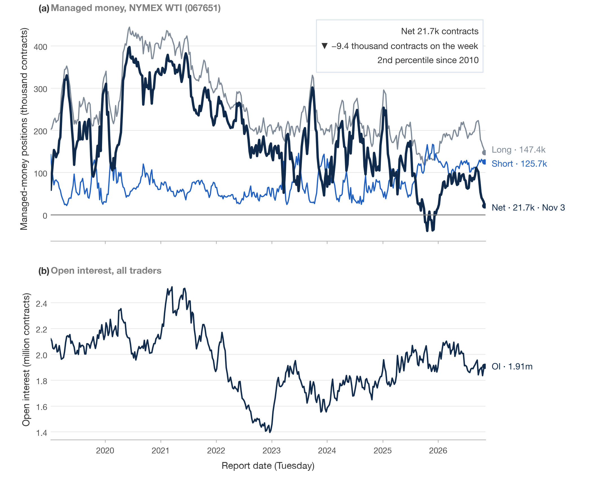
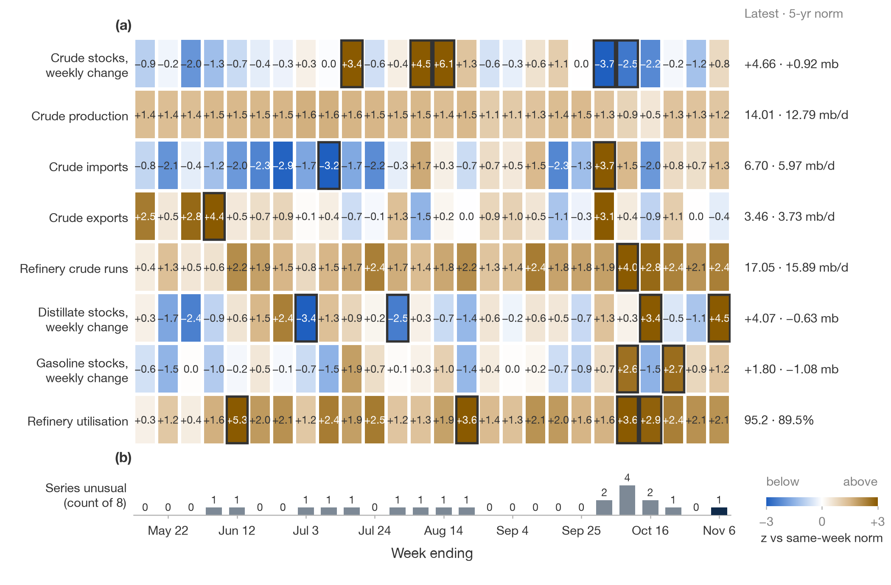
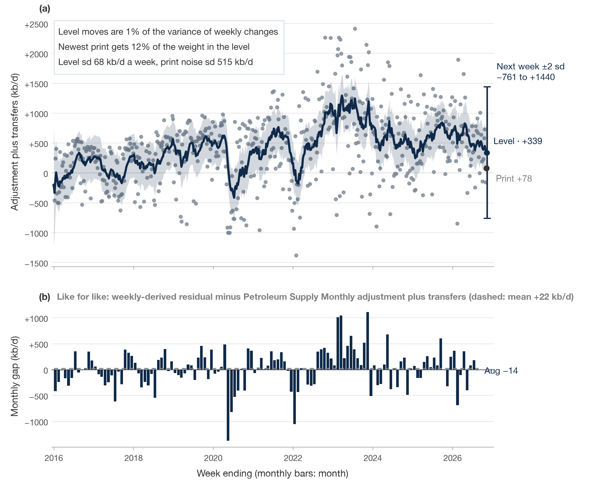
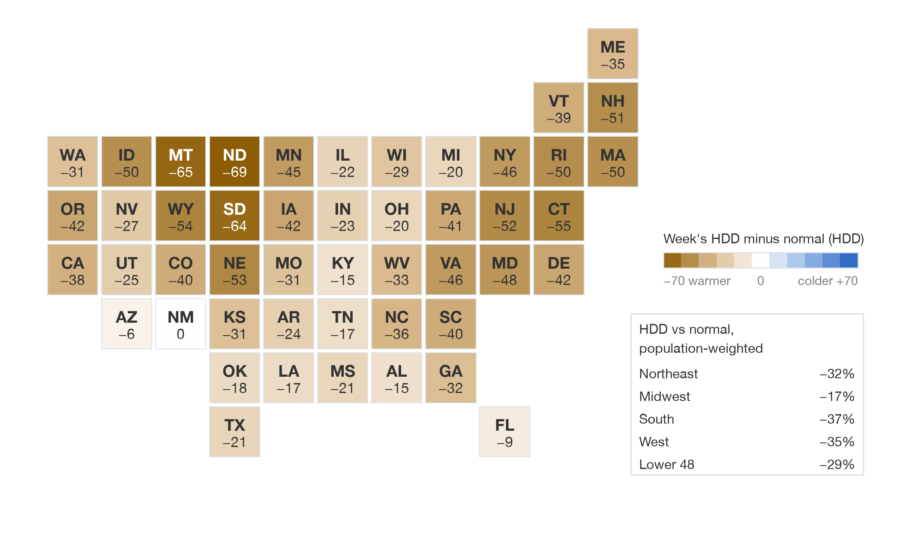
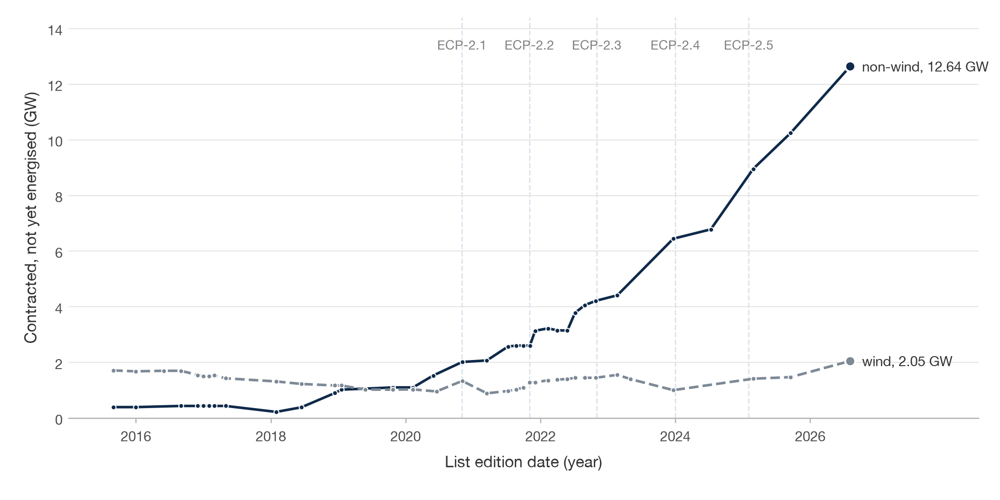
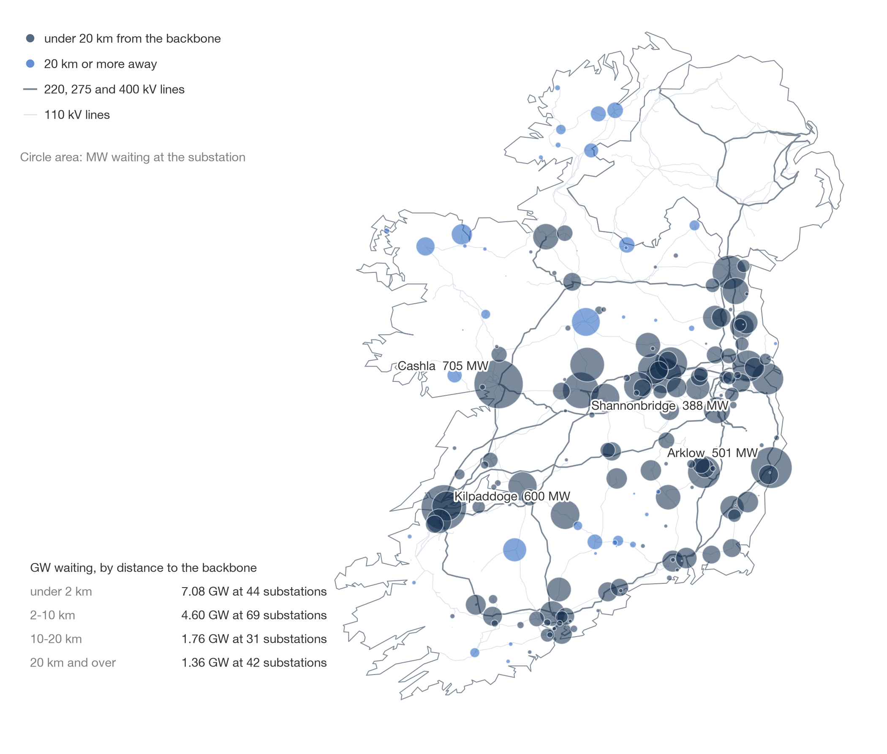

### Hi, I'm Riko

I write [Kardamow](https://kardamow.com), an independent research publication on energy markets, and I build the data tools I need to do it. Mostly oil and gas, some power, and the geopolitics that moves both.

What I forecast is frozen and hashed before the number comes out, scored against the first print, and kept when it misses.

#### What I am building for oil, gas and power desks

**Vessel desk** (private for now): Sentinel-1 radar against AIS in the Hormuz approaches. Of 127 ships seen on radar on 3 Nov 2026, 82 had no AIS nearby: a lead to check on chokepoint flows, never proof (coastal clutter makes 82 an upper bound; about 35 to 56 is plausible). Contains modified Copernicus Sentinel data 2026; AIS presence <a href="https://globalfishingwatch.org">Powered by Global Fishing Watch</a> (CC BY-NC 4.0, non-commercial). **Weather desk** (private for now): ECMWF's 10 Nov 2026 run, US 2 m temperature against the 1991 to 2020 normal out to 15 days: +2.5 °C at 3 days, +1.0 °C at 15, the heating demand gas and power desks trade. One run, not a scored forecast. ECMWF open data (CC BY 4.0), anomaly by me; NCEP-NCAR Reanalysis 1 from NOAA PSL; Natural Earth.

**What moved US crude this week:** imports rose 324 kb/d, the largest mover, and commercial stocks built 4.7 mb (EIA, week ending 6 Nov 2026). **How crowded WTI is:** money managers are net long 21.7k contracts, the lowest since Dec 2025 and the 2nd percentile since 2010 (CFTC, positions of 3 Nov 2026). Public domain.

How I came to this

 

I came to this from finance and data work, where much of the job was cleaning numbers. That taught me to trust a number only once I have seen where it came from. I studied management at UCD Smurfit and I am now doing a part-time MSc in Energy Economics and Finance at the University of Aberdeen. In the evenings I turn public data into something I can test.

<!-- stocks:chart -->
<picture>
  <source media="(prefers-color-scheme: dark)" srcset="assets/stocks-dark.svg">
  
</picture>

*Figure: US commercial crude stocks are 19 mb below the five-year average. Stocks by ISO week excluding the Strategic Petroleum Reserve: 2026 so far (solid), 2025 (dashed), and the 2021 to 2025 range (shaded) and average (dotted). Units: mb; weekly. Source: US Energy Information Administration, Weekly Petroleum Status Report, series WCESTUS1; public domain; as of 2026-11-06.*
<!-- /stocks:chart -->

The numbers behind the chart

 

<!-- stocks:table -->
| | mb |
|:--|--:|
| Stocks, week ending 6 Nov 2026 | 414.4 |
| Change on the week | +4.7 |
| Same week of 2025 | 427.6 |
| 2021 to 2025 average | 433.0 |
| Gap to that average | −18.6 |
| 2021 to 2025 range | 427.6 to 439.4 |
<!-- /stocks:table -->

This is the series behind my weekly forecasting record for US crude stocks, with gas storage to follow. The record goes public once there are enough weeks to judge it.

#### From the weekly chart book

Pages from the public edition of the chart book I build on each EIA weekly release. Click one to open it full size.

Two more: Cushing, and heating demand

 

Source: U.S. EIA, Weekly Petroleum Status Report, week ending 6 Nov 2026, released 12 Nov 2026; CFTC Commitments of Traders, positions of 3 Nov 2026; NOAA Climate Prediction Center, week to 12 Nov 2026. Public domain.

#### Projects

**[nordcast](https://github.com/rikokardamow/nordcast)** forecasts the electricity imbalance in western Denmark every quarter-hour, 15, 30 and 60 minutes ahead: which way the grid operator will have to balance, and by how many megawatts.

Source: Energinet, Energi Data Service; CC BY 4.0. The replay runs on estimated data vintages and is not the live record.

How each forecast is kept

 

1. Written to a file before its deadline and hashed.
2. The day's hashes are timestamped with OpenTimestamps.
3. Scored against the first figure Energinet publishes.
4. Never revised, so the misses and the missed deadlines stay in the table.

Persistence is the forecast on the record. A LightGBM challenger is frozen and scored on the same terms, and it can only take over by passing a test set out in advance, not before 1 April 2027. The record started on 28 October 2026.

**[ie-grid-pipeline](https://github.com/rikokardamow/ie-grid-pipeline)** keeps a record of Ireland's grid connection queue, read from every list EirGrid and ESB Networks have published since 2015. Each new list replaces the last, so without a record the history disappears.

Source: EirGrid contracted lists, Supported by EirGrid Group Data; ESB Networks DSO lists, © ESB Networks, used with their permission.

What the record shows, and where the queue sits

 

- 16.57 GW has signed to connect but is not connected yet. Solar is a third of it.
- 15 of the 16 wind projects that could be checked connected after their target date.
- Under the capacity auction's rules, 2.0 to 2.1 GW of the 12.0 GW with a published rating counts towards keeping the lights on, and more than half of that is gas.

Figures from the report of 30 October 2026.

Source: EirGrid contracted lists, Supported by EirGrid Group Data; ESB Networks DSO lists, © ESB Networks, used with their permission; lines and substations © OpenStreetMap contributors (ODbL).

#### In progress, private for now

These are built in private repositories and open once they have a record worth judging. They are here so you can see where the work is going.

- **Weather desk:** ECMWF's open 2 m temperature forecast for the contiguous US against the 1991 to 2020 normal, drawn as a map loop on every run (map at the top).
- **Vessel desk:** Sentinel-1 radar detections in the Strait of Hormuz approaches checked against AIS, for chokepoint flows (map at the top).
- **Desk site:** a static research site that publishes the weather and vessel maps and the market snapshots in one place.
- **Markets lab:** research-only scans of energy-linked perpetuals on Hyperliquid (basis, funding, liquidity) and a recorder of Polymarket energy questions. Public read data only; there is no trading code.
- **Fuel price elasticity:** a two-page memo on how US gasoline and distillate demand responds when the pump price moves market-wide, with pre-registered tests.
- **US gas storage record:** next, built the same way as the crude record above.

#### What I keep coming back to

- The shape of the futures curve, and the moments when the price of physical barrels and the price of paper contracts disagree
- Sanctions, and the gap between when a policy is announced and when barrels actually move
- Pipelines, terminals and refineries as the real limit on how fast anything changes

**Tools:** Python, SQL, DuckDB, Postgres, pandas, matplotlib, plotnine, Next.js. Public data from the EIA, Energinet, EirGrid, GIE, ENTSO-E and the CFTC.

**Find me** at [kardamow.com](https://kardamow.com) and [@kardamow on X](https://x.com/kardamow).

<!-- built -->
Stocks chart drawn by <code>build/build.py</code> from EIA data, last built for the week ending 6 Nov 2026. The other charts come from the repositories named beside them.
<!-- /built -->
