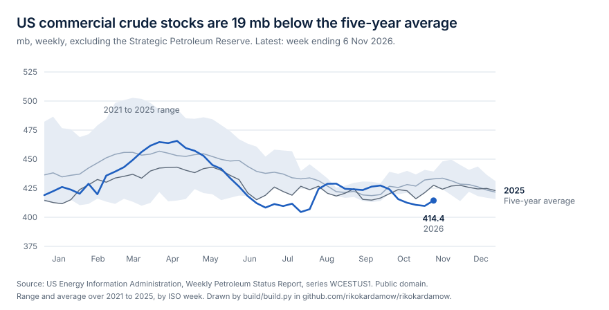

### Hi, I'm Riko

I write [Kardamow](https://kardamow.com), an independent research publication on energy markets, and I build the data tools I need to do it. Mostly oil and gas, some power, and the geopolitics that moves both.

What I forecast is frozen and hashed before the number comes out, scored against the first print, and kept when it misses.

<details>
<summary>How I came to this</summary>

<br>

I came to this from finance and data work, where much of the job was cleaning numbers. That taught me to trust a number only once I have seen where it came from. I studied management at UCD Smurfit and I am now doing a part-time MSc in Energy Economics and Finance at the University of Aberdeen. In the evenings I turn public data into something I can test.

</details>

<!-- stocks:chart -->
<picture>
  <source media="(prefers-color-scheme: dark)" srcset="assets/stocks-dark.svg">
  
</picture>
<!-- /stocks:chart -->

<details>
<summary>The numbers behind the chart</summary>

<br>

<!-- stocks:table -->
| | mb |
|:--|--:|
| Stocks, week ending 6 Nov 2026 | 414.4 |
| Change on the week | +4.7 |
| Same week of 2025 | 427.6 |
| 2021 to 2025 average | 433.0 |
| Gap to that average | −18.6 |
| 2021 to 2025 range | 427.6 to 439.4 |
<!-- /stocks:table -->

</details>

This is the series behind my weekly forecasting record for US crude stocks, with gas storage to follow. The record goes public once there are enough weeks to judge it.

#### Projects

**[nordcast](https://github.com/rikokardamow/nordcast)** forecasts the electricity imbalance in western Denmark every quarter-hour, 15, 30 and 60 minutes ahead: which way the grid operator will have to balance, and by how many megawatts.

<details>
<summary>How each forecast is kept</summary>

<br>

1. Written to a file before its deadline and hashed.
2. The day's hashes are timestamped with OpenTimestamps.
3. Scored against the first figure Energinet publishes.
4. Never revised, so the misses and the missed deadlines stay in the table.

Persistence is the forecast on the record. A LightGBM challenger is frozen and scored on the same terms, and it can only take over by passing a test set out in advance, not before 1 April 2027. The record started on 28 October 2026.

</details>

**[ie-grid-pipeline](https://github.com/rikokardamow/ie-grid-pipeline)** keeps a record of Ireland's grid connection queue, read from every list EirGrid and ESB Networks have published since 2015. Each new list replaces the last, so without a record the history disappears.

<details>
<summary>What the record shows</summary>

<br>

- 16.57 GW has signed to connect but is not connected yet. Solar is a third of it.
- 15 of the 16 wind projects that could be checked connected after their target date.
- Under the capacity auction's rules, 2.0 to 2.1 GW of the 12.0 GW with a published rating counts towards keeping the lights on, and more than half of that is gas.

Figures from the report of 30 October 2026.

</details>

#### Where the work is

Click a point or a line to see what it is.

```geojson
{
  "type": "FeatureCollection",
  "features": [
    {
      "type": "Feature",
      "properties": {
        "Project": "nordcast",
        "Forecast": "DK1 power imbalance, every quarter-hour, 15, 30 and 60 minutes ahead",
        "Scored against": "Energinet's first published figure",
        "Record since": "28 October 2026",
        "marker-color": "#1F5FBF"
      },
      "geometry": { "type": "Point", "coordinates": [9.74, 55.56] }
    },
    {
      "type": "Feature",
      "properties": {
        "Project": "ie-grid-pipeline",
        "Record": "Every EirGrid and ESB Networks connection list since 2015",
        "Waiting to connect": "16.57 GW (report of 30 October 2026)",
        "marker-color": "#1F5FBF"
      },
      "geometry": { "type": "Point", "coordinates": [-6.23, 53.33] }
    },
    {
      "type": "Feature",
      "properties": {
        "Project": "US crude stocks record",
        "Forecast": "Weekly change in US commercial crude stocks, frozen before the EIA release",
        "Why Cushing": "The delivery point for WTI; the record covers all US commercial stocks",
        "Status": "Private until there are enough weeks to judge it",
        "marker-color": "#0F2A4A"
      },
      "geometry": { "type": "Point", "coordinates": [-96.77, 35.99] }
    },
    {
      "type": "Feature",
      "properties": {
        "Project": "US gas storage record",
        "Status": "Next, built the same way",
        "Why Henry Hub": "The delivery point for NYMEX natural gas, at Erath, Louisiana",
        "marker-color": "#7D8996"
      },
      "geometry": { "type": "Point", "coordinates": [-92.04, 29.96] }
    },
    {
      "type": "Feature",
      "properties": {
        "Interconnector": "East West (EWIC)",
        "Links": "Woodland, Co. Meath to Deeside, Wales",
        "Capacity": "500 MW, in service",
        "Drawn as": "A straight line between converter stations, not the cable route",
        "stroke": "#5B6878",
        "stroke-width": 2
      },
      "geometry": { "type": "LineString", "coordinates": [[-6.53, 53.47], [-3.06, 53.23]] }
    },
    {
      "type": "Feature",
      "properties": {
        "Interconnector": "Moyle",
        "Links": "Islandmagee, Co. Antrim to Auchencrosh, Ayrshire",
        "Capacity": "500 MW, in service",
        "Drawn as": "A straight line between converter stations, not the cable route",
        "stroke": "#5B6878",
        "stroke-width": 2
      },
      "geometry": { "type": "LineString", "coordinates": [[-5.77, 54.83], [-4.95, 55.07]] }
    },
    {
      "type": "Feature",
      "properties": {
        "Interconnector": "Greenlink",
        "Links": "Great Island, Co. Wexford to Pembroke, Wales",
        "Capacity": "500 MW, in commercial operation since early 2025",
        "Drawn as": "A straight line between converter stations, not the cable route",
        "stroke": "#5B6878",
        "stroke-width": 2
      },
      "geometry": { "type": "LineString", "coordinates": [[-6.98, 52.35], [-4.99, 51.68]] }
    },
    {
      "type": "Feature",
      "properties": {
        "Interconnector": "Celtic",
        "Links": "Ballyadam, east Cork to La Martyre, Brittany",
        "Capacity": "700 MW, under construction; EirGrid expects commissioning in Q4 2028",
        "Drawn as": "A straight line between converter stations, not the cable route",
        "stroke": "#93A5BB",
        "stroke-width": 2
      },
      "geometry": { "type": "LineString", "coordinates": [[-8.25, 51.93], [-4.16, 48.45]] }
    }
  ]
}
```

#### US crude stocks, 2010 to 2025, as an object

<!-- stocks:model -->
Drag to turn it and scroll to zoom. Weeks run along the long side, January to December, and years run across it from 2010 to 2025. Height is stocks above 250 mb. The step up from 2014 to 2016 is the shale glut, 144 mb on the yearly average. The highest point is the week ending 19 Jun 2020, at 540.7 mb, the most since the series began in 1982.

```stl
solid us_crude_stocks_2010_2025
facet normal 0.138 -0.511 0.848
outer loop
vertex -75 -54 19.83
vertex -69 -54 18.85
vertex -69 -46.8 23.19
endloop
endfacet
facet normal -0.376 -0.116 0.919
outer loop
vertex -75 -54 19.83
vertex -69 -46.8 23.19
vertex -75 -46.8 20.74
endloop
endfacet
facet normal -0.235 -0.46 0.856
outer loop
vertex -69 -54 18.85
vertex -63 -54 20.5
vertex -63 -46.8 24.37
endloop
endfacet
facet normal -0.165 -0.509 0.845
outer loop
vertex -69 -54 18.85
vertex -63 -46.8 24.37
vertex -69 -46.8 23.19
endloop
endfacet
facet normal -0.329 -0.258 0.908
outer loop
vertex -63 -54 20.5
vertex -57 -54 22.68
vertex -57 -46.8 24.72
endloop
endfacet
facet normal -0.052 -0.472 0.88
outer loop
vertex -63 -54 20.5
vertex -57 -46.8 24.72
vertex -63 -46.8 24.37
endloop
endfacet
facet normal -0.209 -0.229 0.951
outer loop
vertex -57 -54 22.68
vertex -51 -54 23.99
vertex -51 -46.8 25.73
endloop
endfacet
facet normal -0.16 -0.269 0.95
outer loop
vertex -57 -54 22.68
vertex -51 -46.8 25.73
vertex -57 -46.8 24.72
endloop
endfacet
facet normal -0.452 -0.021 0.892
outer loop
vertex -51 -54 23.99
vertex -45 -54 27.03
vertex -45 -46.8 27.21
endloop
endfacet
facet normal -0.233 -0.228 0.945
outer loop
vertex -51 -54 23.99
vertex -45 -46.8 27.21
vertex -51 -46.8 25.73
endloop
endfacet
facet normal -0.136 -0.087 0.987
outer loop
vertex -45 -54 27.03
vertex -39 -54 27.86
vertex -39 -46.8 28.5
endloop
endfacet
facet normal -0.21 -0.024 0.977
outer loop
vertex -45 -54 27.03
vertex -39 -46.8 28.5
vertex -45 -46.8 27.21
endloop
endfacet
facet normal -0.097 -0.078 0.992
outer loop
vertex -39 -54 27.86
vertex -33 -54 28.45
vertex -33 -46.8 29.01
endloop
endfacet
facet normal -0.086 -0.087 0.992
outer loop
vertex -39 -54 27.86
vertex -33 -46.8 29.01
vertex -39 -46.8 28.5
endloop
endfacet
facet normal -0.243 -0.23 0.942
outer loop
vertex -33 -54 28.45
vertex -27 -54 30
vertex -27 -46.8 31.76
endloop
endfacet
facet normal -0.415 -0.071 0.907
outer loop
vertex -33 -54 28.45
vertex -27 -46.8 31.76
vertex -33 -46.8 29.01
endloop
endfacet
facet normal -0.125 -0.225 0.966
outer loop
vertex -27 -54 30
vertex -21 -54 30.77
vertex -21 -46.8 32.45
endloop
endfacet
facet normal -0.112 -0.236 0.965
outer loop
vertex -27 -54 30
vertex -21 -46.8 32.45
vertex -27 -46.8 31.76
endloop
endfacet
facet normal 0.078 -0.323 0.943
outer loop
vertex -21 -54 30.77
vertex -15 -54 30.28
vertex -15 -46.8 32.74
endloop
endfacet
facet normal -0.047 -0.227 0.973
outer loop
vertex -21 -54 30.77
vertex -15 -46.8 32.74
vertex -21 -46.8 32.45
endloop
endfacet
facet normal -0.102 0.044 0.994
outer loop
vertex -15 -54 30.28
vertex -9 -54 30.89
vertex -9 -46.8 30.57
endloop
endfacet
facet normal 0.324 -0.306 0.895
outer loop
vertex -15 -54 30.28
vertex -9 -46.8 30.57
vertex -15 -46.8 32.74
endloop
endfacet
facet normal 0.188 0.139 0.972
outer loop
vertex -9 -54 30.89
vertex -3 -54 29.73
vertex -3 -46.8 28.7
endloop
endfacet
facet normal 0.297 0.042 0.954
outer loop
vertex -9 -54 30.89
vertex -3 -46.8 28.7
vertex -9 -46.8 30.57
endloop
endfacet
facet normal 0.377 0.048 0.925
outer loop
vertex -3 -54 29.73
vertex 3 -54 27.29
vertex 3 -46.8 26.91
endloop
endfacet
facet normal 0.283 0.136 0.949
outer loop
vertex -3 -54 29.73
vertex 3 -46.8 26.91
vertex -3 -46.8 28.7
endloop
endfacet
facet normal -0.307 0.265 0.914
outer loop
vertex 3 -54 27.29
vertex 9 -54 29.3
vertex 9 -46.8 27.21
endloop
endfacet
facet normal -0.05 0.052 0.997
outer loop
vertex 3 -54 27.29
vertex 9 -46.8 27.21
vertex 3 -46.8 26.91
endloop
endfacet
facet normal 0.251 0.177 0.952
outer loop
vertex 9 -54 29.3
vertex 15 -54 27.71
vertex 15 -46.8 26.37
endloop
endfacet
facet normal 0.132 0.276 0.952
outer loop
vertex 9 -54 29.3
vertex 15 -46.8 26.37
vertex 9 -46.8 27.21
endloop
endfacet
facet normal -0.273 0.291 0.917
outer loop
vertex 15 -54 27.71
vertex 21 -54 29.5
vertex 21 -46.8 27.21
endloop
endfacet
facet normal -0.136 0.181 0.974
outer loop
vertex 15 -54 27.71
vertex 21 -46.8 27.21
vertex 15 -46.8 26.37
endloop
endfacet
facet normal 0.065 0.426 0.902
outer loop
vertex 21 -54 29.5
vertex 27 -54 29.07
vertex 27 -46.8 25.67
endloop
endfacet
facet normal 0.238 0.294 0.926
outer loop
vertex 21 -54 29.5
vertex 27 -46.8 25.67
vertex 21 -46.8 27.21
endloop
endfacet
facet normal 0.021 0.667 0.745
outer loop
vertex 27 -54 29.07
vertex 33 -54 28.9
vertex 33 -46.8 22.46
endloop
endfacet
facet normal 0.436 0.384 0.814
outer loop
vertex 27 -54 29.07
vertex 33 -46.8 22.46
vertex 27 -46.8 25.67
endloop
endfacet
facet normal -0.086 0.751 0.655
outer loop
vertex 33 -54 28.9
vertex 39 -54 29.69
vertex 39 -46.8 21.44
endloop
endfacet
facet normal 0.126 0.661 0.739
outer loop
vertex 33 -54 28.9
vertex 39 -46.8 21.44
vertex 33 -46.8 22.46
endloop
endfacet
facet normal -0.096 0.802 0.589
outer loop
vertex 39 -54 29.69
vertex 45 -54 30.67
vertex 45 -46.8 20.86
endloop
endfacet
facet normal 0.063 0.752 0.656
outer loop
vertex 39 -54 29.69
vertex 45 -46.8 20.86
vertex 39 -46.8 21.44
endloop
endfacet
facet normal -0.088 0.796 0.599
outer loop
vertex 45 -54 30.67
vertex 51 -54 31.56
vertex 51 -46.8 21.98
endloop
endfacet
facet normal -0.11 0.801 0.588
outer loop
vertex 45 -54 30.67
vertex 51 -46.8 21.98
vertex 45 -46.8 20.86
endloop
endfacet
facet normal 0.293 0.726 0.623
outer loop
vertex 51 -54 31.56
vertex 57 -54 28.74
vertex 57 -46.8 20.35
endloop
endfacet
facet normal 0.162 0.789 0.593
outer loop
vertex 51 -54 31.56
vertex 57 -46.8 20.35
vertex 51 -46.8 21.98
endloop
endfacet
facet normal 0.018 0.733 0.68
outer loop
vertex 57 -54 28.74
vertex 63 -54 28.58
vertex 63 -46.8 20.81
endloop
endfacet
facet normal -0.05 0.758 0.65
outer loop
vertex 57 -54 28.74
vertex 63 -46.8 20.81
vertex 57 -46.8 20.35
endloop
endfacet
facet normal 0.547 0.487 0.681
outer loop
vertex 63 -54 28.58
vertex 69 -54 23.76
vertex 69 -46.8 18.61
endloop
endfacet
facet normal 0.241 0.712 0.66
outer loop
vertex 63 -54 28.58
vertex 69 -46.8 18.61
vertex 63 -46.8 20.81
endloop
endfacet
facet normal 0.288 0.395 0.872
outer loop
vertex 69 -54 23.76
vertex 75 -54 21.78
vertex 75 -46.8 18.52
endloop
endfacet
facet normal 0.013 0.581 0.813
outer loop
vertex 69 -54 23.76
vertex 75 -46.8 18.52
vertex 69 -46.8 18.61
endloop
endfacet
facet normal -0.354 0.357 0.864
outer loop
vertex -75 -46.8 20.74
vertex -69 -46.8 23.19
vertex -69 -39.6 20.22
endloop
endfacet
facet normal -0.205 0.239 0.949
outer loop
vertex -75 -46.8 20.74
vertex -69 -39.6 20.22
vertex -75 -39.6 18.92
endloop
endfacet
facet normal -0.174 0.42 0.891
outer loop
vertex -69 -46.8 23.19
vertex -63 -46.8 24.37
vertex -63 -39.6 20.97
endloop
endfacet
facet normal -0.116 0.379 0.918
outer loop
vertex -69 -46.8 23.19
vertex -63 -39.6 20.97
vertex -69 -39.6 20.22
endloop
endfacet
facet normal -0.055 0.333 0.941
outer loop
vertex -63 -46.8 24.37
vertex -57 -46.8 24.72
vertex -57 -39.6 22.17
endloop
endfacet
facet normal -0.178 0.419 0.89
outer loop
vertex -63 -46.8 24.37
vertex -57 -39.6 22.17
vertex -63 -39.6 20.97
endloop
endfacet
facet normal -0.159 0.301 0.94
outer loop
vertex -57 -46.8 24.72
vertex -51 -46.8 25.73
vertex -51 -39.6 23.43
endloop
endfacet
facet normal -0.193 0.327 0.925
outer loop
vertex -57 -46.8 24.72
vertex -51 -39.6 23.43
vertex -57 -39.6 22.17
endloop
endfacet
facet normal -0.225 0.343 0.912
outer loop
vertex -51 -46.8 25.73
vertex -45 -46.8 27.21
vertex -45 -39.6 24.5
endloop
endfacet
facet normal -0.169 0.301 0.939
outer loop
vertex -51 -46.8 25.73
vertex -45 -39.6 24.5
vertex -51 -39.6 23.43
endloop
endfacet
facet normal -0.209 -0.078 0.975
outer loop
vertex -45 -46.8 27.21
vertex -39 -46.8 28.5
vertex -39 -39.6 29.07
endloop
endfacet
facet normal -0.58 0.286 0.762
outer loop
vertex -45 -46.8 27.21
vertex -39 -39.6 29.07
vertex -45 -39.6 24.5
endloop
endfacet
facet normal -0.082 -0.316 0.945
outer loop
vertex -39 -46.8 28.5
vertex -33 -46.8 29.01
vertex -33 -39.6 31.42
endloop
endfacet
facet normal -0.364 -0.074 0.928
outer loop
vertex -39 -46.8 28.5
vertex -33 -39.6 31.42
vertex -39 -39.6 29.07
endloop
endfacet
facet normal -0.402 -0.26 0.878
outer loop
vertex -33 -46.8 29.01
vertex -27 -46.8 31.76
vertex -27 -39.6 33.89
endloop
endfacet
facet normal -0.363 -0.296 0.884
outer loop
vertex -33 -46.8 29.01
vertex -27 -39.6 33.89
vertex -33 -39.6 31.42
endloop
endfacet
facet normal -0.106 -0.399 0.911
outer loop
vertex -27 -46.8 31.76
vertex -21 -46.8 32.45
vertex -21 -39.6 35.61
endloop
endfacet
facet normal -0.265 -0.274 0.925
outer loop
vertex -27 -46.8 31.76
vertex -21 -39.6 35.61
vertex -27 -39.6 33.89
endloop
endfacet
facet normal -0.043 -0.432 0.901
outer loop
vertex -21 -46.8 32.45
vertex -15 -46.8 32.74
vertex -15 -39.6 36.2
endloop
endfacet
facet normal -0.089 -0.4 0.912
outer loop
vertex -21 -46.8 32.45
vertex -15 -39.6 36.2
vertex -21 -39.6 35.61
endloop
endfacet
facet normal 0.272 -0.6 0.752
outer loop
vertex -15 -46.8 32.74
vertex -9 -46.8 30.57
vertex -9 -39.6 36.31
endloop
endfacet
facet normal -0.018 -0.433 0.901
outer loop
vertex -15 -46.8 32.74
vertex -9 -39.6 36.31
vertex -15 -39.6 36.2
endloop
endfacet
facet normal 0.213 -0.697 0.684
outer loop
vertex -9 -46.8 30.57
vertex -3 -46.8 28.7
vertex -3 -39.6 36.04
endloop
endfacet
facet normal 0.036 -0.623 0.781
outer loop
vertex -9 -46.8 30.57
vertex -3 -39.6 36.04
vertex -9 -39.6 36.31
endloop
endfacet
facet normal 0.214 -0.665 0.716
outer loop
vertex -3 -46.8 28.7
vertex 3 -46.8 26.91
vertex 3 -39.6 33.6
endloop
endfacet
facet normal 0.274 -0.686 0.674
outer loop
vertex -3 -46.8 28.7
vertex 3 -39.6 33.6
vertex -3 -39.6 36.04
endloop
endfacet
facet normal -0.038 -0.644 0.764
outer loop
vertex 3 -46.8 26.91
vertex 9 -46.8 27.21
vertex 9 -39.6 33.28
endloop
endfacet
facet normal 0.038 -0.68 0.732
outer loop
vertex 3 -46.8 26.91
vertex 9 -39.6 33.28
vertex 3 -39.6 33.6
endloop
endfacet
facet normal 0.121 -0.48 0.869
outer loop
vertex 9 -46.8 27.21
vertex 15 -46.8 26.37
vertex 15 -39.6 30.35
endloop
endfacet
facet normal 0.35 -0.604 0.716
outer loop
vertex 9 -46.8 27.21
vertex 15 -39.6 30.35
vertex 9 -39.6 33.28
endloop
endfacet
facet normal -0.136 -0.184 0.973
outer loop
vertex 15 -46.8 26.37
vertex 21 -46.8 27.21
vertex 21 -39.6 28.58
endloop
endfacet
facet normal 0.25 -0.468 0.847
outer loop
vertex 15 -46.8 26.37
vertex 21 -39.6 28.58
vertex 15 -39.6 30.35
endloop
endfacet
facet normal 0.245 -0.174 0.954
outer loop
vertex 21 -46.8 27.21
vertex 27 -46.8 25.67
vertex 27 -39.6 26.98
endloop
endfacet
facet normal 0.253 -0.18 0.951
outer loop
vertex 21 -46.8 27.21
vertex 27 -39.6 26.98
vertex 21 -39.6 28.58
endloop
endfacet
facet normal 0.355 -0.66 0.663
outer loop
vertex 27 -46.8 25.67
vertex 33 -46.8 22.46
vertex 33 -39.6 29.63
endloop
endfacet
facet normal -0.398 -0.164 0.903
outer loop
vertex 27 -46.8 25.67
vertex 33 -39.6 29.63
vertex 27 -39.6 26.98
endloop
endfacet
facet normal 0.114 -0.733 0.67
outer loop
vertex 33 -46.8 22.46
vertex 39 -46.8 21.44
vertex 39 -39.6 29.32
endloop
endfacet
facet normal 0.037 -0.705 0.708
outer loop
vertex 33 -46.8 22.46
vertex 39 -39.6 29.32
vertex 33 -39.6 29.63
endloop
endfacet
facet normal 0.054 -0.827 0.56
outer loop
vertex 39 -46.8 21.44
vertex 45 -46.8 20.86
vertex 45 -39.6 31.48
endloop
endfacet
facet normal -0.237 -0.717 0.655
outer loop
vertex 39 -46.8 21.44
vertex 45 -39.6 31.48
vertex 39 -39.6 29.32
endloop
endfacet
facet normal -0.108 -0.808 0.579
outer loop
vertex 45 -46.8 20.86
vertex 51 -46.8 21.98
vertex 51 -39.6 32.04
endloop
endfacet
facet normal -0.052 -0.827 0.56
outer loop
vertex 45 -46.8 20.86
vertex 51 -39.6 32.04
vertex 45 -39.6 31.48
endloop
endfacet
facet normal 0.138 -0.85 0.508
outer loop
vertex 51 -46.8 21.98
vertex 57 -46.8 20.35
vertex 57 -39.6 32.41
endloop
endfacet
facet normal -0.036 -0.812 0.582
outer loop
vertex 51 -46.8 21.98
vertex 57 -39.6 32.41
vertex 51 -39.6 32.04
endloop
endfacet
facet normal -0.042 -0.833 0.552
outer loop
vertex 57 -46.8 20.35
vertex 63 -46.8 20.81
vertex 63 -39.6 31.66
endloop
endfacet
facet normal 0.064 -0.857 0.512
outer loop
vertex 57 -46.8 20.35
vertex 63 -39.6 31.66
vertex 57 -39.6 32.41
endloop
endfacet
facet normal 0.179 -0.853 0.49
outer loop
vertex 63 -46.8 20.81
vertex 69 -46.8 18.61
vertex 69 -39.6 31.16
endloop
endfacet
facet normal 0.046 -0.832 0.552
outer loop
vertex 63 -46.8 20.81
vertex 69 -39.6 31.16
vertex 63 -39.6 31.66
endloop
endfacet
facet normal 0.009 -0.823 0.567
outer loop
vertex 69 -46.8 18.61
vertex 75 -46.8 18.52
vertex 75 -39.6 28.97
endloop
endfacet
facet normal 0.179 -0.853 0.49
outer loop
vertex 69 -46.8 18.61
vertex 75 -39.6 28.97
vertex 69 -39.6 31.16
endloop
endfacet
facet normal -0.135 -0.767 0.627
outer loop
vertex -75 -39.6 18.92
vertex -69 -39.6 20.22
vertex -69 -32.4 29.03
endloop
endfacet
facet normal -0.187 -0.744 0.641
outer loop
vertex -75 -39.6 18.92
vertex -69 -32.4 29.03
vertex -75 -32.4 27.28
endloop
endfacet
facet normal -0.074 -0.806 0.587
outer loop
vertex -69 -39.6 20.22
vertex -63 -39.6 20.97
vertex -63 -32.4 30.87
endloop
endfacet
facet normal -0.191 -0.76 0.621
outer loop
vertex -69 -39.6 20.22
vertex -63 -32.4 30.87
vertex -69 -32.4 29.03
endloop
endfacet
facet normal -0.113 -0.816 0.567
outer loop
vertex -63 -39.6 20.97
vertex -57 -39.6 22.17
vertex -57 -32.4 32.52
endloop
endfacet
facet normal -0.159 -0.798 0.581
outer loop
vertex -63 -39.6 20.97
vertex -57 -32.4 32.52
vertex -63 -32.4 30.87
endloop
endfacet
facet normal -0.114 -0.83 0.546
outer loop
vertex -57 -39.6 22.17
vertex -51 -39.6 23.43
vertex -51 -32.4 34.37
endloop
endfacet
facet normal -0.174 -0.808 0.562
outer loop
vertex -57 -39.6 22.17
vertex -51 -32.4 34.37
vertex -57 -32.4 32.52
endloop
endfacet
facet normal -0.102 -0.818 0.566
outer loop
vertex -51 -39.6 23.43
vertex -45 -39.6 24.5
vertex -45 -32.4 34.91
endloop
endfacet
facet normal -0.049 -0.834 0.549
outer loop
vertex -51 -39.6 23.43
vertex -45 -32.4 34.91
vertex -51 -32.4 34.37
endloop
endfacet
facet normal -0.473 -0.625 0.621
outer loop
vertex -45 -39.6 24.5
vertex -39 -39.6 29.07
vertex -39 -32.4 36.32
endloop
endfacet
facet normal -0.133 -0.815 0.564
outer loop
vertex -45 -39.6 24.5
vertex -39 -32.4 36.32
vertex -45 -32.4 34.91
endloop
endfacet
facet normal -0.313 -0.513 0.799
outer loop
vertex -39 -39.6 29.07
vertex -33 -39.6 31.42
vertex -33 -32.4 36.05
endloop
endfacet
facet normal 0.032 -0.709 0.704
outer loop
vertex -39 -39.6 29.07
vertex -33 -32.4 36.05
vertex -39 -32.4 36.32
endloop
endfacet
facet normal -0.328 -0.508 0.797
outer loop
vertex -33 -39.6 31.42
vertex -27 -39.6 33.89
vertex -27 -32.4 38.48
endloop
endfacet
facet normal -0.322 -0.512 0.796
outer loop
vertex -33 -39.6 31.42
vertex -27 -32.4 38.48
vertex -33 -32.4 36.05
endloop
endfacet
facet normal -0.26 -0.335 0.906
outer loop
vertex -27 -39.6 33.89
vertex -21 -39.6 35.61
vertex -21 -32.4 38.28
endloop
endfacet
facet normal 0.028 -0.537 0.843
outer loop
vertex -27 -39.6 33.89
vertex -21 -32.4 38.28
vertex -27 -32.4 38.48
endloop
endfacet
facet normal -0.094 -0.264 0.96
outer loop
vertex -21 -39.6 35.61
vertex -15 -39.6 36.2
vertex -15 -32.4 38.18
endloop
endfacet
facet normal 0.016 -0.347 0.938
outer loop
vertex -21 -39.6 35.61
vertex -15 -32.4 38.18
vertex -21 -32.4 38.28
endloop
endfacet
facet normal -0.019 -0.236 0.972
outer loop
vertex -15 -39.6 36.2
vertex -9 -39.6 36.31
vertex -9 -32.4 38.06
endloop
endfacet
facet normal 0.018 -0.265 0.964
outer loop
vertex -15 -39.6 36.2
vertex -9 -32.4 38.06
vertex -15 -32.4 38.18
endloop
endfacet
facet normal 0.046 -0.052 0.998
outer loop
vertex -9 -39.6 36.31
vertex -3 -39.6 36.04
vertex -3 -32.4 36.41
endloop
endfacet
facet normal 0.258 -0.228 0.939
outer loop
vertex -9 -39.6 36.31
vertex -3 -32.4 36.41
vertex -9 -32.4 38.06
endloop
endfacet
facet normal 0.348 0.385 0.855
outer loop
vertex -3 -39.6 36.04
vertex 3 -39.6 33.6
vertex 3 -32.4 30.35
endloop
endfacet
facet normal 0.71 -0.037 0.703
outer loop
vertex -3 -39.6 36.04
vertex 3 -32.4 30.35
vertex -3 -32.4 36.41
endloop
endfacet
facet normal 0.043 0.565 0.824
outer loop
vertex 3 -39.6 33.6
vertex 9 -39.6 33.28
vertex 9 -32.4 28.35
endloop
endfacet
facet normal 0.291 0.393 0.872
outer loop
vertex 3 -39.6 33.6
vertex 9 -32.4 28.35
vertex 3 -32.4 30.35
endloop
endfacet
facet normal 0.413 0.337 0.846
outer loop
vertex 9 -39.6 33.28
vertex 15 -39.6 30.35
vertex 15 -32.4 27.49
endloop
endfacet
facet normal 0.118 0.561 0.819
outer loop
vertex 9 -39.6 33.28
vertex 15 -32.4 27.49
vertex 9 -32.4 28.35
endloop
endfacet
facet normal 0.278 0.2 0.94
outer loop
vertex 15 -39.6 30.35
vertex 21 -39.6 28.58
vertex 21 -32.4 27.04
endloop
endfacet
facet normal 0.068 0.369 0.927
outer loop
vertex 15 -39.6 30.35
vertex 21 -32.4 27.04
vertex 15 -32.4 27.49
endloop
endfacet
facet normal 0.257 0.021 0.966
outer loop
vertex 21 -39.6 28.58
vertex 27 -39.6 26.98
vertex 27 -32.4 26.83
endloop
endfacet
facet normal 0.035 0.208 0.977
outer loop
vertex 21 -39.6 28.58
vertex 27 -32.4 26.83
vertex 21 -32.4 27.04
endloop
endfacet
facet normal -0.361 0.445 0.819
outer loop
vertex 27 -39.6 26.98
vertex 33 -39.6 29.63
vertex 33 -32.4 25.72
endloop
endfacet
facet normal 0.182 0.021 0.983
outer loop
vertex 27 -39.6 26.98
vertex 33 -32.4 25.72
vertex 27 -32.4 26.83
endloop
endfacet
facet normal 0.052 0.034 0.998
outer loop
vertex 33 -39.6 29.63
vertex 39 -39.6 29.32
vertex 39 -32.4 29.07
endloop
endfacet
facet normal -0.441 0.428 0.789
outer loop
vertex 33 -39.6 29.63
vertex 39 -32.4 29.07
vertex 33 -32.4 25.72
endloop
endfacet
facet normal -0.337 -0.115 0.934
outer loop
vertex 39 -39.6 29.32
vertex 45 -39.6 31.48
vertex 45 -32.4 32.37
endloop
endfacet
facet normal -0.481 0.029 0.876
outer loop
vertex 39 -39.6 29.32
vertex 45 -32.4 32.37
vertex 39 -32.4 29.07
endloop
endfacet
facet normal -0.086 -0.355 0.931
outer loop
vertex 45 -39.6 31.48
vertex 51 -39.6 32.04
vertex 51 -32.4 34.78
endloop
endfacet
facet normal -0.37 -0.114 0.922
outer loop
vertex 45 -39.6 31.48
vertex 51 -32.4 34.78
vertex 45 -32.4 32.37
endloop
endfacet
facet normal -0.056 -0.437 0.898
outer loop
vertex 51 -39.6 32.04
vertex 57 -39.6 32.41
vertex 57 -32.4 35.91
endloop
endfacet
facet normal -0.173 -0.351 0.92
outer loop
vertex 51 -39.6 32.04
vertex 57 -32.4 35.91
vertex 51 -32.4 34.78
endloop
endfacet
facet normal 0.106 -0.515 0.85
outer loop
vertex 57 -39.6 32.41
vertex 63 -39.6 31.66
vertex 63 -32.4 36.03
endloop
endfacet
facet normal -0.017 -0.437 0.899
outer loop
vertex 57 -39.6 32.41
vertex 63 -32.4 36.03
vertex 57 -32.4 35.91
endloop
endfacet
facet normal 0.083 0.024 0.996
outer loop
vertex 63 -39.6 31.66
vertex 69 -39.6 31.16
vertex 69 -32.4 30.99
endloop
endfacet
facet normal 0.583 -0.421 0.695
outer loop
vertex 63 -39.6 31.66
vertex 69 -32.4 30.99
vertex 63 -32.4 36.03
endloop
endfacet
facet normal 0.338 0.153 0.928
outer loop
vertex 69 -39.6 31.16
vertex 75 -39.6 28.97
vertex 75 -32.4 27.79
endloop
endfacet
facet normal 0.471 0.021 0.882
outer loop
vertex 69 -39.6 31.16
vertex 75 -32.4 27.79
vertex 69 -32.4 30.99
endloop
endfacet
facet normal -0.236 0.543 0.806
outer loop
vertex -75 -32.4 27.28
vertex -69 -32.4 29.03
vertex -69 -25.2 24.18
endloop
endfacet
facet normal -0.019 0.408 0.913
outer loop
vertex -75 -32.4 27.28
vertex -69 -25.2 24.18
vertex -75 -25.2 24.06
endloop
endfacet
facet normal -0.245 0.552 0.797
outer loop
vertex -69 -32.4 29.03
vertex -63 -32.4 30.87
vertex -63 -25.2 25.89
endloop
endfacet
facet normal -0.23 0.543 0.807
outer loop
vertex -69 -32.4 29.03
vertex -63 -25.2 25.89
vertex -69 -25.2 24.18
endloop
endfacet
facet normal -0.209 0.613 0.762
outer loop
vertex -63 -32.4 30.87
vertex -57 -32.4 32.52
vertex -57 -25.2 26.73
endloop
endfacet
facet normal -0.114 0.565 0.817
outer loop
vertex -63 -32.4 30.87
vertex -57 -25.2 26.73
vertex -63 -25.2 25.89
endloop
endfacet
facet normal -0.228 0.635 0.738
outer loop
vertex -57 -32.4 32.52
vertex -51 -32.4 34.37
vertex -51 -25.2 28.18
endloop
endfacet
facet normal -0.185 0.616 0.766
outer loop
vertex -57 -32.4 32.52
vertex -51 -25.2 28.18
vertex -57 -25.2 26.73
endloop
endfacet
facet normal -0.083 0.354 0.932
outer loop
vertex -51 -32.4 34.37
vertex -45 -32.4 34.91
vertex -45 -25.2 32.17
endloop
endfacet
facet normal -0.45 0.582 0.677
outer loop
vertex -51 -32.4 34.37
vertex -45 -25.2 32.17
vertex -51 -25.2 28.18
endloop
endfacet
facet normal -0.21 0.396 0.894
outer loop
vertex -45 -32.4 34.91
vertex -39 -32.4 36.32
vertex -39 -25.2 33.13
endloop
endfacet
facet normal -0.147 0.351 0.925
outer loop
vertex -45 -32.4 34.91
vertex -39 -25.2 33.13
vertex -45 -25.2 32.17
endloop
endfacet
facet normal 0.044 -0.218 0.975
outer loop
vertex -39 -32.4 36.32
vertex -33 -32.4 36.05
vertex -33 -25.2 37.66
endloop
endfacet
facet normal -0.568 0.334 0.752
outer loop
vertex -39 -32.4 36.32
vertex -33 -25.2 37.66
vertex -39 -25.2 33.13
endloop
endfacet
facet normal -0.375 -0.008 0.927
outer loop
vertex -33 -32.4 36.05
vertex -27 -32.4 38.48
vertex -27 -25.2 38.54
endloop
endfacet
facet normal -0.142 -0.216 0.966
outer loop
vertex -33 -32.4 36.05
vertex -27 -25.2 38.54
vertex -33 -25.2 37.66
endloop
endfacet
facet normal 0.033 0.12 0.992
outer loop
vertex -27 -32.4 38.48
vertex -21 -32.4 38.28
vertex -21 -25.2 37.4
endloop
endfacet
facet normal 0.187 -0.009 0.982
outer loop
vertex -27 -32.4 38.48
vertex -21 -25.2 37.4
vertex -27 -25.2 38.54
endloop
endfacet
facet normal 0.016 0.266 0.964
outer loop
vertex -21 -32.4 38.28
vertex -15 -32.4 38.18
vertex -15 -25.2 36.19
endloop
endfacet
facet normal 0.197 0.118 0.973
outer loop
vertex -21 -32.4 38.28
vertex -15 -25.2 36.19
vertex -21 -25.2 37.4
endloop
endfacet
facet normal 0.017 0.43 0.902
outer loop
vertex -15 -32.4 38.18
vertex -9 -32.4 38.06
vertex -9 -25.2 34.63
endloop
endfacet
facet normal 0.243 0.258 0.935
outer loop
vertex -15 -32.4 38.18
vertex -9 -25.2 34.63
vertex -15 -25.2 36.19
endloop
endfacet
facet normal 0.258 0.237 0.937
outer loop
vertex -9 -32.4 38.06
vertex -3 -32.4 36.41
vertex -3 -25.2 34.59
endloop
endfacet
facet normal 0.006 0.43 0.903
outer loop
vertex -9 -32.4 38.06
vertex -3 -25.2 34.59
vertex -9 -25.2 34.63
endloop
endfacet
facet normal 0.701 -0.162 0.694
outer loop
vertex -3 -32.4 36.41
vertex 3 -32.4 30.35
vertex 3 -25.2 32.03
endloop
endfacet
facet normal 0.382 0.227 0.896
outer loop
vertex -3 -32.4 36.41
vertex 3 -25.2 32.03
vertex -3 -25.2 34.59
endloop
endfacet
facet normal 0.315 -0.068 0.946
outer loop
vertex 3 -32.4 30.35
vertex 9 -32.4 28.35
vertex 9 -25.2 28.87
endloop
endfacet
facet normal 0.457 -0.202 0.866
outer loop
vertex 3 -32.4 30.35
vertex 9 -25.2 28.87
vertex 3 -25.2 32.03
endloop
endfacet
facet normal 0.142 -0.071 0.987
outer loop
vertex 9 -32.4 28.35
vertex 15 -32.4 27.49
vertex 15 -25.2 28.01
endloop
endfacet
facet normal 0.142 -0.071 0.987
outer loop
vertex 9 -32.4 28.35
vertex 15 -25.2 28.01
vertex 9 -25.2 28.87
endloop
endfacet
facet normal 0.073 0.086 0.994
outer loop
vertex 15 -32.4 27.49
vertex 21 -32.4 27.04
vertex 21 -25.2 26.42
endloop
endfacet
facet normal 0.255 -0.07 0.964
outer loop
vertex 15 -32.4 27.49
vertex 21 -25.2 26.42
vertex 15 -25.2 28.01
endloop
endfacet
facet normal 0.035 0.159 0.987
outer loop
vertex 21 -32.4 27.04
vertex 27 -32.4 26.83
vertex 27 -25.2 25.67
endloop
endfacet
facet normal 0.124 0.086 0.989
outer loop
vertex 21 -32.4 27.04
vertex 27 -25.2 25.67
vertex 21 -25.2 26.42
endloop
endfacet
facet normal 0.182 -0.046 0.982
outer loop
vertex 27 -32.4 26.83
vertex 33 -32.4 25.72
vertex 33 -25.2 26.06
endloop
endfacet
facet normal -0.065 0.159 0.985
outer loop
vertex 27 -32.4 26.83
vertex 33 -25.2 26.06
vertex 27 -25.2 25.67
endloop
endfacet
facet normal -0.452 0.377 0.808
outer loop
vertex 33 -32.4 25.72
vertex 39 -32.4 29.07
vertex 39 -25.2 25.71
endloop
endfacet
facet normal 0.057 -0.047 0.997
outer loop
vertex 33 -32.4 25.72
vertex 39 -25.2 25.71
vertex 33 -25.2 26.06
endloop
endfacet
facet normal -0.471 0.206 0.858
outer loop
vertex 39 -32.4 29.07
vertex 45 -32.4 32.37
vertex 45 -25.2 30.64
endloop
endfacet
facet normal -0.597 0.339 0.727
outer loop
vertex 39 -32.4 29.07
vertex 45 -25.2 30.64
vertex 39 -25.2 25.71
endloop
endfacet
facet normal -0.359 0.274 0.892
outer loop
vertex 45 -32.4 32.37
vertex 51 -32.4 34.78
vertex 51 -25.2 32.57
endloop
endfacet
facet normal -0.298 0.223 0.928
outer loop
vertex 45 -32.4 32.37
vertex 51 -25.2 32.57
vertex 45 -25.2 30.64
endloop
endfacet
facet normal -0.165 0.456 0.875
outer loop
vertex 51 -32.4 34.78
vertex 57 -32.4 35.91
vertex 57 -25.2 32.16
endloop
endfacet
facet normal 0.066 0.293 0.954
outer loop
vertex 51 -32.4 34.78
vertex 57 -25.2 32.16
vertex 51 -25.2 32.57
endloop
endfacet
facet normal -0.017 0.427 0.904
outer loop
vertex 57 -32.4 35.91
vertex 63 -32.4 36.03
vertex 63 -25.2 32.62
endloop
endfacet
facet normal -0.068 0.461 0.885
outer loop
vertex 57 -32.4 35.91
vertex 63 -25.2 32.62
vertex 57 -25.2 32.16
endloop
endfacet
facet normal 0.637 -0.139 0.758
outer loop
vertex 63 -32.4 36.03
vertex 69 -32.4 30.99
vertex 69 -25.2 32.3
endloop
endfacet
facet normal 0.048 0.427 0.903
outer loop
vertex 63 -32.4 36.03
vertex 69 -25.2 32.3
vertex 63 -25.2 32.62
endloop
endfacet
facet normal 0.369 -0.622 0.691
outer loop
vertex 69 -32.4 30.99
vertex 75 -32.4 27.79
vertex 75 -25.2 34.27
endloop
endfacet
facet normal -0.307 -0.171 0.936
outer loop
vertex 69 -32.4 30.99
vertex 75 -25.2 34.27
vertex 69 -25.2 32.3
endloop
endfacet
facet normal -0.009 -0.901 0.433
outer loop
vertex -75 -25.2 24.06
vertex -69 -25.2 24.18
vertex -69 -18 39.17
endloop
endfacet
facet normal -0.498 -0.689 0.526
outer loop
vertex -75 -25.2 24.06
vertex -69 -18 39.17
vertex -75 -18 33.5
endloop
endfacet
facet normal -0.107 -0.92 0.377
outer loop
vertex -69 -25.2 24.18
vertex -63 -25.2 25.89
vertex -63 -18 43.44
endloop
endfacet
facet normal -0.294 -0.861 0.414
outer loop
vertex -69 -25.2 24.18
vertex -63 -18 43.44
vertex -69 -18 39.17
endloop
endfacet
facet normal -0.044 -0.947 0.319
outer loop
vertex -63 -25.2 25.89
vertex -57 -25.2 26.73
vertex -57 -18 48.09
endloop
endfacet
facet normal -0.282 -0.888 0.364
outer loop
vertex -63 -25.2 25.89
vertex -57 -18 48.09
vertex -63 -18 43.44
endloop
endfacet
facet normal -0.066 -0.96 0.271
outer loop
vertex -57 -25.2 26.73
vertex -51 -25.2 28.18
vertex -51 -18 53.74
endloop
endfacet
facet normal -0.288 -0.908 0.306
outer loop
vertex -57 -25.2 26.73
vertex -51 -18 53.74
vertex -57 -18 48.09
endloop
endfacet
facet normal -0.169 -0.952 0.254
outer loop
vertex -51 -25.2 28.18
vertex -45 -25.2 32.17
vertex -45 -18 59.11
endloop
endfacet
facet normal -0.236 -0.935 0.264
outer loop
vertex -51 -25.2 28.18
vertex -45 -18 59.11
vertex -51 -18 53.74
endloop
endfacet
facet normal -0.036 -0.973 0.227
outer loop
vertex -45 -25.2 32.17
vertex -39 -25.2 33.13
vertex -39 -18 63.96
endloop
endfacet
facet normal -0.204 -0.946 0.253
outer loop
vertex -45 -25.2 32.17
vertex -39 -18 63.96
vertex -45 -18 59.11
endloop
endfacet
facet normal -0.176 -0.956 0.233
outer loop
vertex -39 -25.2 33.13
vertex -33 -25.2 37.66
vertex -33 -18 67.19
endloop
endfacet
facet normal -0.122 -0.967 0.226
outer loop
vertex -39 -25.2 33.13
vertex -33 -18 67.19
vertex -39 -18 63.96
endloop
endfacet
facet normal -0.035 -0.971 0.237
outer loop
vertex -33 -25.2 37.66
vertex -27 -25.2 38.54
vertex -27 -18 68.02
endloop
endfacet
facet normal -0.033 -0.971 0.237
outer loop
vertex -33 -25.2 37.66
vertex -27 -18 68.02
vertex -33 -18 67.19
endloop
endfacet
facet normal 0.046 -0.969 0.242
outer loop
vertex -27 -25.2 38.54
vertex -21 -25.2 37.4
vertex -21 -18 66.18
endloop
endfacet
facet normal 0.073 -0.969 0.237
outer loop
vertex -27 -25.2 38.54
vertex -21 -18 66.18
vertex -27 -18 68.02
endloop
endfacet
facet normal 0.05 -0.968 0.246
outer loop
vertex -21 -25.2 37.4
vertex -15 -25.2 36.19
vertex -15 -18 64.49
endloop
endfacet
facet normal 0.068 -0.968 0.242
outer loop
vertex -21 -25.2 37.4
vertex -15 -18 64.49
vertex -21 -18 66.18
endloop
endfacet
facet normal 0.067 -0.964 0.256
outer loop
vertex -15 -25.2 36.19
vertex -9 -25.2 34.63
vertex -9 -18 61.75
endloop
endfacet
facet normal 0.112 -0.963 0.245
outer loop
vertex -15 -25.2 36.19
vertex -9 -18 61.75
vertex -15 -18 64.49
endloop
endfacet
facet normal 0.002 -0.962 0.272
outer loop
vertex -9 -25.2 34.63
vertex -3 -25.2 34.59
vertex -3 -18 60.07
endloop
endfacet
facet normal 0.071 -0.964 0.256
outer loop
vertex -9 -25.2 34.63
vertex -3 -18 60.07
vertex -9 -18 61.75
endloop
endfacet
facet normal 0.106 -0.963 0.249
outer loop
vertex -3 -25.2 34.59
vertex 3 -25.2 32.03
vertex 3 -18 59.91
endloop
endfacet
facet normal 0.007 -0.962 0.272
outer loop
vertex -3 -25.2 34.59
vertex 3 -18 59.91
vertex -3 -18 60.07
endloop
endfacet
facet normal 0.12 -0.966 0.228
outer loop
vertex 3 -25.2 32.03
vertex 9 -25.2 28.87
vertex 9 -18 59.31
endloop
endfacet
facet normal 0.025 -0.968 0.25
outer loop
vertex 3 -25.2 32.03
vertex 9 -18 59.31
vertex 3 -18 59.91
endloop
endfacet
facet normal 0.035 -0.97 0.241
outer loop
vertex 9 -25.2 28.87
vertex 15 -25.2 28.01
vertex 15 -18 56.93
endloop
endfacet
facet normal 0.091 -0.969 0.229
outer loop
vertex 9 -25.2 28.87
vertex 15 -18 56.93
vertex 9 -18 59.31
endloop
endfacet
facet normal 0.061 -0.971 0.231
outer loop
vertex 15 -25.2 28.01
vertex 21 -25.2 26.42
vertex 21 -18 56.67
endloop
endfacet
facet normal 0.011 -0.97 0.242
outer loop
vertex 15 -25.2 28.01
vertex 21 -18 56.67
vertex 15 -18 56.93
endloop
endfacet
facet normal 0.028 -0.975 0.219
outer loop
vertex 21 -25.2 26.42
vertex 27 -25.2 25.67
vertex 27 -18 57.7
endloop
endfacet
facet normal -0.04 -0.972 0.231
outer loop
vertex 21 -25.2 26.42
vertex 27 -18 57.7
vertex 21 -18 56.67
endloop
endfacet
facet normal -0.015 -0.974 0.226
outer loop
vertex 27 -25.2 25.67
vertex 33 -25.2 26.06
vertex 33 -18 57.09
endloop
endfacet
facet normal 0.022 -0.975 0.219
outer loop
vertex 27 -25.2 25.67
vertex 33 -18 57.09
vertex 27 -18 57.7
endloop
endfacet
facet normal 0.012 -0.977 0.214
outer loop
vertex 33 -25.2 26.06
vertex 39 -25.2 25.71
vertex 39 -18 58.58
endloop
endfacet
facet normal -0.056 -0.973 0.226
outer loop
vertex 33 -25.2 26.06
vertex 39 -18 58.58
vertex 33 -18 57.09
endloop
endfacet
facet normal -0.176 -0.961 0.214
outer loop
vertex 39 -25.2 25.71
vertex 45 -25.2 30.64
vertex 45 -18 62.9
endloop
endfacet
facet normal -0.152 -0.965 0.212
outer loop
vertex 39 -25.2 25.71
vertex 45 -18 62.9
vertex 39 -18 58.58
endloop
endfacet
facet normal -0.068 -0.975 0.211
outer loop
vertex 45 -25.2 30.64
vertex 51 -25.2 32.57
vertex 51 -18 65.81
endloop
endfacet
facet normal -0.105 -0.971 0.217
outer loop
vertex 45 -25.2 30.64
vertex 51 -18 65.81
vertex 45 -18 62.9
endloop
endfacet
facet normal 0.014 -0.98 0.199
outer loop
vertex 51 -25.2 32.57
vertex 57 -25.2 32.16
vertex 57 -18 67.63
endloop
endfacet
facet normal -0.064 -0.975 0.211
outer loop
vertex 51 -25.2 32.57
vertex 57 -18 67.63
vertex 51 -18 65.81
endloop
endfacet
facet normal -0.015 -0.98 0.198
outer loop
vertex 57 -25.2 32.16
vertex 63 -25.2 32.62
vertex 63 -18 68.19
endloop
endfacet
facet normal -0.018 -0.98 0.199
outer loop
vertex 57 -25.2 32.16
vertex 63 -18 68.19
vertex 57 -18 67.63
endloop
endfacet
facet normal 0.011 -0.98 0.198
outer loop
vertex 63 -25.2 32.62
vertex 69 -25.2 32.3
vertex 69 -18 67.96
endloop
endfacet
facet normal 0.007 -0.98 0.198
outer loop
vertex 63 -25.2 32.62
vertex 69 -18 67.96
vertex 63 -18 68.19
endloop
endfacet
facet normal -0.07 -0.975 0.213
outer loop
vertex 69 -25.2 32.3
vertex 75 -25.2 34.27
vertex 75 -18 67.25
endloop
endfacet
facet normal 0.024 -0.98 0.198
outer loop
vertex 69 -25.2 32.3
vertex 75 -18 67.25
vertex 69 -18 67.96
endloop
endfacet
facet normal -0.2 -0.957 0.211
outer loop
vertex -75 -18 33.5
vertex -69 -18 39.17
vertex -69 -10.8 71.76
endloop
endfacet
facet normal -0.162 -0.965 0.207
outer loop
vertex -75 -18 33.5
vertex -69 -10.8 71.76
vertex -75 -10.8 67.05
endloop
endfacet
facet normal -0.165 -0.959 0.232
outer loop
vertex -69 -18 39.17
vertex -63 -18 43.44
vertex -63 -10.8 73.18
endloop
endfacet
facet normal -0.051 -0.975 0.215
outer loop
vertex -69 -18 39.17
vertex -63 -10.8 73.18
vertex -69 -10.8 71.76
endloop
endfacet
facet normal -0.188 -0.952 0.242
outer loop
vertex -63 -18 43.44
vertex -57 -18 48.09
vertex -57 -10.8 76.4
endloop
endfacet
facet normal -0.125 -0.964 0.233
outer loop
vertex -63 -18 43.44
vertex -57 -10.8 76.4
vertex -63 -10.8 73.18
endloop
endfacet
facet normal -0.244 -0.935 0.259
outer loop
vertex -57 -18 48.09
vertex -51 -18 53.74
vertex -51 -10.8 79.7
endloop
endfacet
facet normal -0.134 -0.96 0.244
outer loop
vertex -57 -18 48.09
vertex -51 -10.8 79.7
vertex -57 -10.8 76.4
endloop
endfacet
facet normal -0.247 -0.929 0.276
outer loop
vertex -51 -18 53.74
vertex -45 -18 59.11
vertex -45 -10.8 83.38
endloop
endfacet
facet normal -0.162 -0.951 0.264
outer loop
vertex -51 -18 53.74
vertex -45 -10.8 83.38
vertex -51 -10.8 79.7
endloop
endfacet
facet normal -0.273 -0.901 0.338
outer loop
vertex -45 -18 59.11
vertex -39 -18 63.96
vertex -39 -10.8 83.13
endloop
endfacet
facet normal 0.012 -0.959 0.284
outer loop
vertex -45 -18 59.11
vertex -39 -10.8 83.13
vertex -45 -10.8 83.38
endloop
endfacet
facet normal -0.196 -0.911 0.363
outer loop
vertex -39 -18 63.96
vertex -33 -18 67.19
vertex -33 -10.8 85.24
endloop
endfacet
facet normal -0.123 -0.929 0.349
outer loop
vertex -39 -18 63.96
vertex -33 -10.8 85.24
vertex -39 -10.8 83.13
endloop
endfacet
facet normal -0.052 -0.926 0.373
outer loop
vertex -33 -18 67.19
vertex -27 -18 68.02
vertex -27 -10.8 85.9
endloop
endfacet
facet normal -0.04 -0.928 0.37
outer loop
vertex -33 -18 67.19
vertex -27 -10.8 85.9
vertex -33 -10.8 85.24
endloop
endfacet
facet normal 0.109 -0.929 0.355
outer loop
vertex -27 -18 68.02
vertex -21 -18 66.18
vertex -21 -10.8 85.04
endloop
endfacet
facet normal 0.054 -0.926 0.373
outer loop
vertex -27 -18 68.02
vertex -21 -10.8 85.04
vertex -27 -10.8 85.9
endloop
endfacet
facet normal 0.099 -0.931 0.353
outer loop
vertex -21 -18 66.18
vertex -15 -18 64.49
vertex -15 -10.8 83.5
endloop
endfacet
facet normal 0.091 -0.93 0.355
outer loop
vertex -21 -18 66.18
vertex -15 -10.8 83.5
vertex -21 -10.8 85.04
endloop
endfacet
facet normal 0.148 -0.935 0.322
outer loop
vertex -15 -18 64.49
vertex -9 -18 61.75
vertex -9 -10.8 82.65
endloop
endfacet
facet normal 0.05 -0.934 0.354
outer loop
vertex -15 -18 64.49
vertex -9 -10.8 82.65
vertex -15 -10.8 83.5
endloop
endfacet
facet normal 0.091 -0.941 0.327
outer loop
vertex -9 -18 61.75
vertex -3 -18 60.07
vertex -3 -10.8 80.79
endloop
endfacet
facet normal 0.1 -0.941 0.324
outer loop
vertex -9 -18 61.75
vertex -3 -10.8 80.79
vertex -9 -10.8 82.65
endloop
endfacet
facet normal 0.009 -0.937 0.35
outer loop
vertex -3 -18 60.07
vertex 3 -18 59.91
vertex 3 -10.8 79.2
endloop
endfacet
facet normal 0.087 -0.941 0.327
outer loop
vertex -3 -18 60.07
vertex 3 -10.8 79.2
vertex -3 -10.8 80.79
endloop
endfacet
facet normal 0.033 -0.942 0.334
outer loop
vertex 3 -18 59.91
vertex 9 -18 59.31
vertex 9 -10.8 79.6
endloop
endfacet
facet normal -0.023 -0.937 0.35
outer loop
vertex 3 -18 59.91
vertex 9 -10.8 79.6
vertex 3 -10.8 79.2
endloop
endfacet
facet normal 0.118 -0.947 0.299
outer loop
vertex 9 -18 59.31
vertex 15 -18 56.93
vertex 15 -10.8 79.77
endloop
endfacet
facet normal -0.009 -0.942 0.334
outer loop
vertex 9 -18 59.31
vertex 15 -10.8 79.77
vertex 9 -10.8 79.6
endloop
endfacet
facet normal 0.013 -0.957 0.289
outer loop
vertex 15 -18 56.93
vertex 21 -18 56.67
vertex 21 -10.8 80.55
endloop
endfacet
facet normal -0.039 -0.953 0.301
outer loop
vertex 15 -18 56.93
vertex 21 -10.8 80.55
vertex 15 -10.8 79.77
endloop
endfacet
facet normal -0.063 -0.929 0.365
outer loop
vertex 21 -18 56.67
vertex 27 -18 57.7
vertex 27 -10.8 76.05
endloop
endfacet
facet normal 0.212 -0.936 0.282
outer loop
vertex 21 -18 56.67
vertex 27 -10.8 76.05
vertex 21 -10.8 80.55
endloop
endfacet
facet normal 0.041 -0.916 0.399
outer loop
vertex 27 -18 57.7
vertex 33 -18 57.09
vertex 33 -10.8 73.6
endloop
endfacet
facet normal 0.147 -0.921 0.361
outer loop
vertex 27 -18 57.7
vertex 33 -10.8 73.6
vertex 27 -10.8 76.05
endloop
endfacet
facet normal -0.11 -0.891 0.441
outer loop
vertex 33 -18 57.09
vertex 39 -18 58.58
vertex 39 -10.8 73.11
endloop
endfacet
facet normal 0.033 -0.916 0.4
outer loop
vertex 33 -18 57.09
vertex 39 -10.8 73.11
vertex 33 -10.8 73.6
endloop
endfacet
facet normal -0.406 -0.719 0.564
outer loop
vertex 39 -18 58.58
vertex 45 -18 62.9
vertex 45 -10.8 72.08
endloop
endfacet
facet normal 0.075 -0.893 0.443
outer loop
vertex 39 -18 58.58
vertex 45 -10.8 72.08
vertex 39 -10.8 73.11
endloop
endfacet
facet normal -0.251 -0.817 0.519
outer loop
vertex 45 -18 62.9
vertex 51 -18 65.81
vertex 51 -10.8 77.15
endloop
endfacet
facet normal -0.462 -0.698 0.547
outer loop
vertex 45 -18 62.9
vertex 51 -10.8 77.15
vertex 45 -10.8 72.08
endloop
endfacet
facet normal -0.16 -0.836 0.525
outer loop
vertex 51 -18 65.81
vertex 57 -18 67.63
vertex 57 -10.8 79.09
endloop
endfacet
facet normal -0.17 -0.832 0.528
outer loop
vertex 51 -18 65.81
vertex 57 -10.8 79.09
vertex 51 -10.8 77.15
endloop
endfacet
facet normal -0.054 -0.811 0.583
outer loop
vertex 57 -18 67.63
vertex 63 -18 68.19
vertex 63 -10.8 78.19
endloop
endfacet
facet normal 0.079 -0.844 0.531
outer loop
vertex 57 -18 67.63
vertex 63 -10.8 78.19
vertex 57 -10.8 79.09
endloop
endfacet
facet normal 0.022 -0.792 0.61
outer loop
vertex 63 -18 68.19
vertex 69 -18 67.96
vertex 69 -10.8 77.33
endloop
endfacet
facet normal 0.084 -0.809 0.582
outer loop
vertex 63 -18 68.19
vertex 69 -10.8 77.33
vertex 63 -10.8 78.19
endloop
endfacet
facet normal 0.072 -0.794 0.603
outer loop
vertex 69 -18 67.96
vertex 75 -18 67.25
vertex 75 -10.8 76.74
endloop
endfacet
facet normal 0.06 -0.791 0.609
outer loop
vertex 69 -18 67.96
vertex 75 -10.8 76.74
vertex 69 -10.8 77.33
endloop
endfacet
facet normal -0.466 -0.656 0.594
outer loop
vertex -75 -10.8 67.05
vertex -69 -10.8 71.76
vertex -69 -3.6 79.7
endloop
endfacet
facet normal -0.223 -0.798 0.56
outer loop
vertex -75 -10.8 67.05
vertex -69 -3.6 79.7
vertex -75 -3.6 77.31
endloop
endfacet
facet normal -0.109 -0.88 0.462
outer loop
vertex -69 -10.8 71.76
vertex -63 -10.8 73.18
vertex -63 -3.6 86.91
endloop
endfacet
facet normal -0.628 -0.577 0.523
outer loop
vertex -69 -10.8 71.76
vertex -63 -3.6 86.91
vertex -69 -3.6 79.7
endloop
endfacet
facet normal -0.259 -0.837 0.482
outer loop
vertex -63 -10.8 73.18
vertex -57 -10.8 76.4
vertex -57 -3.6 88.91
endloop
endfacet
facet normal -0.153 -0.875 0.459
outer loop
vertex -63 -10.8 73.18
vertex -57 -3.6 88.91
vertex -63 -3.6 86.91
endloop
endfacet
facet normal -0.27 -0.828 0.491
outer loop
vertex -57 -10.8 76.4
vertex -51 -10.8 79.7
vertex -51 -3.6 91.83
endloop
endfacet
facet normal -0.236 -0.842 0.485
outer loop
vertex -57 -10.8 76.4
vertex -51 -3.6 91.83
vertex -57 -3.6 88.91
endloop
endfacet
facet normal -0.334 -0.77 0.544
outer loop
vertex -51 -10.8 79.7
vertex -45 -10.8 83.38
vertex -45 -3.6 93.57
endloop
endfacet
facet normal -0.146 -0.851 0.505
outer loop
vertex -51 -10.8 79.7
vertex -45 -3.6 93.57
vertex -51 -3.6 91.83
endloop
endfacet
facet normal 0.023 -0.83 0.557
outer loop
vertex -45 -10.8 83.38
vertex -39 -10.8 83.13
vertex -39 -3.6 93.87
endloop
endfacet
facet normal -0.029 -0.816 0.577
outer loop
vertex -45 -10.8 83.38
vertex -39 -3.6 93.87
vertex -45 -3.6 93.57
endloop
endfacet
facet normal -0.239 -0.693 0.68
outer loop
vertex -39 -10.8 83.13
vertex -33 -10.8 85.24
vertex -33 -3.6 92.57
endloop
endfacet
facet normal 0.12 -0.825 0.553
outer loop
vertex -39 -10.8 83.13
vertex -33 -3.6 92.57
vertex -39 -3.6 93.87
endloop
endfacet
facet normal -0.09 -0.561 0.823
outer loop
vertex -33 -10.8 85.24
vertex -27 -10.8 85.9
vertex -27 -3.6 90.8
endloop
endfacet
facet normal 0.203 -0.699 0.686
outer loop
vertex -33 -10.8 85.24
vertex -27 -3.6 90.8
vertex -33 -3.6 92.57
endloop
endfacet
facet normal 0.127 -0.442 0.888
outer loop
vertex -27 -10.8 85.9
vertex -21 -10.8 85.04
vertex -21 -3.6 88.62
endloop
endfacet
facet normal 0.287 -0.539 0.792
outer loop
vertex -27 -10.8 85.9
vertex -21 -3.6 88.62
vertex -27 -3.6 90.8
endloop
endfacet
facet normal 0.232 -0.354 0.906
outer loop
vertex -21 -10.8 85.04
vertex -15 -10.8 83.5
vertex -15 -3.6 86.31
endloop
endfacet
facet normal 0.326 -0.422 0.846
outer loop
vertex -21 -10.8 85.04
vertex -15 -3.6 86.31
vertex -21 -3.6 88.62
endloop
endfacet
facet normal 0.128 -0.409 0.904
outer loop
vertex -15 -10.8 83.5
vertex -9 -10.8 82.65
vertex -9 -3.6 85.91
endloop
endfacet
facet normal 0.063 -0.364 0.929
outer loop
vertex -15 -10.8 83.5
vertex -9 -3.6 85.91
vertex -15 -3.6 86.31
endloop
endfacet
facet normal 0.265 -0.441 0.857
outer loop
vertex -9 -10.8 82.65
vertex -3 -10.8 80.79
vertex -3 -3.6 84.5
endloop
endfacet
facet normal 0.209 -0.403 0.891
outer loop
vertex -9 -10.8 82.65
vertex -3 -3.6 84.5
vertex -9 -3.6 85.91
endloop
endfacet
facet normal 0.254 -0.131 0.958
outer loop
vertex -3 -10.8 80.79
vertex 3 -10.8 79.2
vertex 3 -3.6 80.19
endloop
endfacet
facet normal 0.539 -0.386 0.749
outer loop
vertex -3 -10.8 80.79
vertex 3 -3.6 80.19
vertex -3 -3.6 84.5
endloop
endfacet
facet normal -0.062 0.364 0.929
outer loop
vertex 3 -10.8 79.2
vertex 9 -10.8 79.6
vertex 9 -3.6 76.77
endloop
endfacet
facet normal 0.491 -0.118 0.863
outer loop
vertex 3 -10.8 79.2
vertex 9 -3.6 76.77
vertex 3 -3.6 80.19
endloop
endfacet
facet normal -0.02 0.689 0.724
outer loop
vertex 9 -10.8 79.6
vertex 15 -10.8 79.77
vertex 15 -3.6 72.92
endloop
endfacet
facet normal 0.513 0.313 0.799
outer loop
vertex 9 -10.8 79.6
vertex 15 -3.6 72.92
vertex 9 -3.6 76.77
endloop
endfacet
facet normal -0.071 0.837 0.543
outer loop
vertex 15 -10.8 79.77
vertex 21 -10.8 80.55
vertex 21 -3.6 69.45
endloop
endfacet
facet normal 0.386 0.636 0.668
outer loop
vertex 15 -10.8 79.77
vertex 21 -3.6 69.45
vertex 15 -3.6 72.92
endloop
endfacet
facet normal 0.525 0.485 0.699
outer loop
vertex 21 -10.8 80.55
vertex 27 -10.8 76.05
vertex 27 -3.6 71.05
endloop
endfacet
facet normal -0.143 0.83 0.539
outer loop
vertex 21 -10.8 80.55
vertex 27 -3.6 71.05
vertex 21 -3.6 69.45
endloop
endfacet
facet normal 0.377 0.047 0.925
outer loop
vertex 27 -10.8 76.05
vertex 33 -10.8 73.6
vertex 33 -3.6 73.23
endloop
endfacet
facet normal -0.286 0.546 0.787
outer loop
vertex 27 -10.8 76.05
vertex 33 -3.6 73.23
vertex 27 -3.6 71.05
endloop
endfacet
facet normal 0.077 0.341 0.937
outer loop
vertex 33 -10.8 73.6
vertex 39 -10.8 73.11
vertex 39 -3.6 70.48
endloop
endfacet
facet normal 0.416 0.046 0.908
outer loop
vertex 33 -10.8 73.6
vertex 39 -3.6 70.48
vertex 33 -3.6 73.23
endloop
endfacet
facet normal 0.149 0.462 0.874
outer loop
vertex 39 -10.8 73.11
vertex 45 -10.8 72.08
vertex 45 -3.6 68.28
endloop
endfacet
facet normal 0.326 0.323 0.888
outer loop
vertex 39 -10.8 73.11
vertex 45 -3.6 68.28
vertex 39 -3.6 70.48
endloop
endfacet
facet normal -0.463 0.697 0.548
outer loop
vertex 45 -10.8 72.08
vertex 51 -10.8 77.15
vertex 51 -3.6 67.99
endloop
endfacet
facet normal 0.043 0.467 0.883
outer loop
vertex 45 -10.8 72.08
vertex 51 -3.6 67.99
vertex 45 -3.6 68.28
endloop
endfacet
facet normal -0.18 0.809 0.559
outer loop
vertex 51 -10.8 77.15
vertex 57 -10.8 79.09
vertex 57 -3.6 68.66
endloop
endfacet
facet normal -0.069 0.784 0.616
outer loop
vertex 51 -10.8 77.15
vertex 57 -3.6 68.66
vertex 51 -3.6 67.99
endloop
endfacet
facet normal 0.077 0.853 0.516
outer loop
vertex 57 -10.8 79.09
vertex 63 -10.8 78.19
vertex 63 -3.6 66.3
endloop
endfacet
facet normal 0.218 0.803 0.555
outer loop
vertex 57 -10.8 79.09
vertex 63 -3.6 66.3
vertex 57 -3.6 68.66
endloop
endfacet
facet normal 0.063 0.896 0.439
outer loop
vertex 63 -10.8 78.19
vertex 69 -10.8 77.33
vertex 69 -3.6 62.61
endloop
endfacet
facet normal 0.303 0.815 0.493
outer loop
vertex 63 -10.8 78.19
vertex 69 -3.6 62.61
vertex 63 -3.6 66.3
endloop
endfacet
facet normal 0.037 0.927 0.372
outer loop
vertex 69 -10.8 77.33
vertex 75 -10.8 76.74
vertex 75 -3.6 58.8
endloop
endfacet
facet normal 0.269 0.865 0.423
outer loop
vertex 69 -10.8 77.33
vertex 75 -3.6 58.8
vertex 69 -3.6 62.61
endloop
endfacet
facet normal -0.109 0.956 0.272
outer loop
vertex -75 -3.6 77.31
vertex -69 -3.6 79.7
vertex -69 3.6 54.44
endloop
endfacet
facet normal 0.019 0.952 0.305
outer loop
vertex -75 -3.6 77.31
vertex -69 3.6 54.44
vertex -75 3.6 54.81
endloop
endfacet
facet normal -0.266 0.938 0.222
outer loop
vertex -69 -3.6 79.7
vertex -63 -3.6 86.91
vertex -63 3.6 56.49
endloop
endfacet
facet normal -0.093 0.958 0.273
outer loop
vertex -69 -3.6 79.7
vertex -63 3.6 56.49
vertex -69 3.6 54.44
endloop
endfacet
facet normal -0.073 0.973 0.218
outer loop
vertex -63 -3.6 86.91
vertex -57 -3.6 88.91
vertex -57 3.6 56.76
endloop
endfacet
facet normal -0.01 0.973 0.23
outer loop
vertex -63 -3.6 86.91
vertex -57 3.6 56.76
vertex -63 3.6 56.49
endloop
endfacet
facet normal -0.103 0.972 0.212
outer loop
vertex -57 -3.6 88.91
vertex -51 -3.6 91.83
vertex -51 3.6 58.88
endloop
endfacet
facet normal -0.077 0.973 0.218
outer loop
vertex -57 -3.6 88.91
vertex -51 3.6 58.88
vertex -57 3.6 56.76
endloop
endfacet
facet normal -0.059 0.977 0.204
outer loop
vertex -51 -3.6 91.83
vertex -45 -3.6 93.57
vertex -45 3.6 59.11
endloop
endfacet
facet normal -0.008 0.977 0.213
outer loop
vertex -51 -3.6 91.83
vertex -45 3.6 59.11
vertex -51 3.6 58.88
endloop
endfacet
facet normal -0.01 0.98 0.199
outer loop
vertex -45 -3.6 93.57
vertex -39 -3.6 93.87
vertex -39 3.6 58.41
endloop
endfacet
facet normal 0.024 0.979 0.204
outer loop
vertex -45 -3.6 93.57
vertex -39 3.6 58.41
vertex -45 3.6 59.11
endloop
endfacet
facet normal 0.045 0.977 0.209
outer loop
vertex -39 -3.6 93.87
vertex -33 -3.6 92.57
vertex -33 3.6 58.96
endloop
endfacet
facet normal -0.018 0.98 0.199
outer loop
vertex -39 -3.6 93.87
vertex -33 3.6 58.96
vertex -39 3.6 58.41
endloop
endfacet
facet normal 0.069 0.97 0.234
outer loop
vertex -33 -3.6 92.57
vertex -27 -3.6 90.8
vertex -27 3.6 61
endloop
endfacet
facet normal -0.071 0.975 0.209
outer loop
vertex -33 -3.6 92.57
vertex -27 3.6 61
vertex -33 3.6 58.96
endloop
endfacet
facet normal 0.091 0.963 0.252
outer loop
vertex -27 -3.6 90.8
vertex -21 -3.6 88.62
vertex -21 3.6 61.13
endloop
endfacet
facet normal -0.005 0.972 0.235
outer loop
vertex -27 -3.6 90.8
vertex -21 3.6 61.13
vertex -27 3.6 61
endloop
endfacet
facet normal 0.106 0.956 0.274
outer loop
vertex -21 -3.6 88.62
vertex -15 -3.6 86.31
vertex -15 3.6 61.23
endloop
endfacet
facet normal -0.004 0.967 0.253
outer loop
vertex -21 -3.6 88.62
vertex -15 3.6 61.23
vertex -21 3.6 61.13
endloop
endfacet
facet normal 0.018 0.965 0.261
outer loop
vertex -15 -3.6 86.31
vertex -9 -3.6 85.91
vertex -9 3.6 59.23
endloop
endfacet
facet normal 0.092 0.957 0.275
outer loop
vertex -15 -3.6 86.31
vertex -9 3.6 59.23
vertex -15 3.6 61.23
endloop
endfacet
facet normal 0.056 0.97 0.238
outer loop
vertex -9 -3.6 85.91
vertex -3 -3.6 84.5
vertex -3 3.6 55.2
endloop
endfacet
facet normal 0.173 0.951 0.257
outer loop
vertex -9 -3.6 85.91
vertex -3 3.6 55.2
vertex -9 3.6 59.23
endloop
endfacet
facet normal 0.176 0.953 0.245
outer loop
vertex -3 -3.6 84.5
vertex 3 -3.6 80.19
vertex 3 3.6 52.19
endloop
endfacet
facet normal 0.118 0.964 0.237
outer loop
vertex -3 -3.6 84.5
vertex 3 3.6 52.19
vertex -3 3.6 55.2
endloop
endfacet
facet normal 0.155 0.949 0.273
outer loop
vertex 3 -3.6 80.19
vertex 9 -3.6 76.77
vertex 9 3.6 51.76
endloop
endfacet
facet normal 0.018 0.968 0.249
outer loop
vertex 3 -3.6 80.19
vertex 9 3.6 51.76
vertex 3 3.6 52.19
endloop
endfacet
facet normal 0.214 0.918 0.333
outer loop
vertex 9 -3.6 76.77
vertex 15 -3.6 72.92
vertex 15 3.6 53.06
endloop
endfacet
facet normal -0.06 0.959 0.276
outer loop
vertex 9 -3.6 76.77
vertex 15 3.6 53.06
vertex 9 3.6 51.76
endloop
endfacet
facet normal 0.213 0.904 0.37
outer loop
vertex 15 -3.6 72.92
vertex 21 -3.6 69.45
vertex 21 3.6 51.83
endloop
endfacet
facet normal 0.07 0.938 0.34
outer loop
vertex 15 -3.6 72.92
vertex 21 3.6 51.83
vertex 15 3.6 53.06
endloop
endfacet
facet normal -0.083 0.947 0.311
outer loop
vertex 21 -3.6 69.45
vertex 27 -3.6 71.05
vertex 27 3.6 49.12
endloop
endfacet
facet normal 0.169 0.912 0.373
outer loop
vertex 21 -3.6 69.45
vertex 27 3.6 49.12
vertex 21 3.6 51.83
endloop
endfacet
facet normal -0.099 0.957 0.272
outer loop
vertex 27 -3.6 71.05
vertex 33 -3.6 73.23
vertex 33 3.6 47.87
endloop
endfacet
facet normal 0.065 0.948 0.311
outer loop
vertex 27 -3.6 71.05
vertex 33 3.6 47.87
vertex 27 3.6 49.12
endloop
endfacet
facet normal 0.162 0.921 0.355
outer loop
vertex 33 -3.6 73.23
vertex 39 -3.6 70.48
vertex 39 3.6 51.8
endloop
endfacet
facet normal -0.176 0.947 0.269
outer loop
vertex 33 -3.6 73.23
vertex 39 3.6 51.8
vertex 33 3.6 47.87
endloop
endfacet
facet normal 0.182 0.849 0.496
outer loop
vertex 39 -3.6 70.48
vertex 45 -3.6 68.28
vertex 45 3.6 55.97
endloop
endfacet
facet normal -0.243 0.905 0.349
outer loop
vertex 39 -3.6 70.48
vertex 45 3.6 55.97
vertex 39 3.6 51.8
endloop
endfacet
facet normal 0.031 0.779 0.626
outer loop
vertex 45 -3.6 68.28
vertex 51 -3.6 67.99
vertex 51 3.6 59.04
endloop
endfacet
facet normal -0.25 0.836 0.489
outer loop
vertex 45 -3.6 68.28
vertex 51 3.6 59.04
vertex 45 3.6 55.97
endloop
endfacet
facet normal -0.095 0.526 0.845
outer loop
vertex 51 -3.6 67.99
vertex 57 -3.6 68.66
vertex 57 3.6 64.18
endloop
endfacet
facet normal -0.473 0.686 0.552
outer loop
vertex 51 -3.6 67.99
vertex 57 3.6 64.18
vertex 51 3.6 59.04
endloop
endfacet
facet normal 0.361 0.172 0.917
outer loop
vertex 57 -3.6 68.66
vertex 63 -3.6 66.3
vertex 63 3.6 64.95
endloop
endfacet
facet normal -0.109 0.525 0.844
outer loop
vertex 57 -3.6 68.66
vertex 63 3.6 64.95
vertex 57 3.6 64.18
endloop
endfacet
facet normal 0.522 -0.077 0.85
outer loop
vertex 63 -3.6 66.3
vertex 69 -3.6 62.61
vertex 69 3.6 63.26
endloop
endfacet
facet normal 0.267 0.177 0.947
outer loop
vertex 63 -3.6 66.3
vertex 69 3.6 63.26
vertex 63 3.6 64.95
endloop
endfacet
facet normal 0.478 -0.456 0.751
outer loop
vertex 69 -3.6 62.61
vertex 75 -3.6 58.8
vertex 75 3.6 63.17
endloop
endfacet
facet normal 0.016 -0.09 0.996
outer loop
vertex 69 -3.6 62.61
vertex 75 3.6 63.17
vertex 69 3.6 63.26
endloop
endfacet
facet normal 0.036 -0.813 0.581
outer loop
vertex -75 3.6 54.81
vertex -69 3.6 54.44
vertex -69 10.8 64.51
endloop
endfacet
facet normal -0.263 -0.69 0.675
outer loop
vertex -75 3.6 54.81
vertex -69 10.8 64.51
vertex -75 10.8 62.17
endloop
endfacet
facet normal -0.206 -0.77 0.604
outer loop
vertex -69 3.6 54.44
vertex -63 3.6 56.49
vertex -63 10.8 65.68
endloop
endfacet
facet normal -0.112 -0.808 0.578
outer loop
vertex -69 3.6 54.44
vertex -63 10.8 65.68
vertex -69 10.8 64.51
endloop
endfacet
facet normal -0.027 -0.791 0.612
outer loop
vertex -63 3.6 56.49
vertex -57 3.6 56.76
vertex -57 10.8 66.06
endloop
endfacet
facet normal -0.039 -0.787 0.616
outer loop
vertex -63 3.6 56.49
vertex -57 10.8 66.06
vertex -63 10.8 65.68
endloop
endfacet
facet normal -0.239 -0.698 0.675
outer loop
vertex -57 3.6 56.76
vertex -51 3.6 58.88
vertex -51 10.8 66.33
endloop
endfacet
facet normal -0.027 -0.791 0.612
outer loop
vertex -57 3.6 56.76
vertex -51 10.8 66.33
vertex -57 10.8 66.06
endloop
endfacet
facet normal -0.034 -0.474 0.88
outer loop
vertex -51 3.6 58.88
vertex -45 3.6 59.11
vertex -45 10.8 62.99
endloop
endfacet
facet normal 0.361 -0.671 0.648
outer loop
vertex -51 3.6 58.88
vertex -45 10.8 62.99
vertex -51 10.8 66.33
endloop
endfacet
facet normal 0.075 -0.764 0.64
outer loop
vertex -45 3.6 59.11
vertex -39 3.6 58.41
vertex -39 10.8 67
endloop
endfacet
facet normal -0.507 -0.409 0.759
outer loop
vertex -45 3.6 59.11
vertex -39 10.8 67
vertex -45 10.8 62.99
endloop
endfacet
facet normal -0.055 -0.8 0.597
outer loop
vertex -39 3.6 58.41
vertex -33 3.6 58.96
vertex -33 10.8 68.6
endloop
endfacet
facet normal -0.169 -0.756 0.633
outer loop
vertex -39 3.6 58.41
vertex -33 10.8 68.6
vertex -39 10.8 67
endloop
endfacet
facet normal -0.182 -0.826 0.534
outer loop
vertex -33 3.6 58.96
vertex -27 3.6 61
vertex -27 10.8 72.13
endloop
endfacet
facet normal -0.332 -0.756 0.564
outer loop
vertex -33 3.6 58.96
vertex -27 10.8 72.13
vertex -33 10.8 68.6
endloop
endfacet
facet normal -0.01 -0.874 0.487
outer loop
vertex -27 3.6 61
vertex -21 3.6 61.13
vertex -21 10.8 74.05
endloop
endfacet
facet normal -0.171 -0.827 0.535
outer loop
vertex -27 3.6 61
vertex -21 10.8 74.05
vertex -27 10.8 72.13
endloop
endfacet
facet normal -0.007 -0.897 0.442
outer loop
vertex -21 3.6 61.13
vertex -15 3.6 61.23
vertex -15 10.8 75.86
endloop
endfacet
facet normal -0.145 -0.864 0.482
outer loop
vertex -21 3.6 61.13
vertex -15 10.8 75.86
vertex -21 10.8 74.05
endloop
endfacet
facet normal 0.123 -0.921 0.369
outer loop
vertex -15 3.6 61.23
vertex -9 3.6 59.23
vertex -9 10.8 77.19
endloop
endfacet
facet normal -0.098 -0.893 0.439
outer loop
vertex -15 3.6 61.23
vertex -9 10.8 77.19
vertex -15 10.8 75.86
endloop
endfacet
facet normal 0.253 -0.892 0.376
outer loop
vertex -9 3.6 59.23
vertex -3 3.6 55.2
vertex -3 10.8 72.28
endloop
endfacet
facet normal 0.291 -0.888 0.356
outer loop
vertex -9 3.6 59.23
vertex -3 10.8 72.28
vertex -9 10.8 77.19
endloop
endfacet
facet normal 0.198 -0.896 0.397
outer loop
vertex -3 3.6 55.2
vertex 3 3.6 52.19
vertex 3 10.8 68.45
endloop
endfacet
facet normal 0.24 -0.894 0.377
outer loop
vertex -3 3.6 55.2
vertex 3 10.8 68.45
vertex -3 10.8 72.28
endloop
endfacet
facet normal 0.039 -0.841 0.54
outer loop
vertex 3 3.6 52.19
vertex 9 3.6 51.76
vertex 9 10.8 62.96
endloop
endfacet
facet normal 0.348 -0.857 0.38
outer loop
vertex 3 3.6 52.19
vertex 9 10.8 62.96
vertex 3 10.8 68.45
endloop
endfacet
facet normal -0.13 -0.792 0.597
outer loop
vertex 9 3.6 51.76
vertex 15 3.6 53.06
vertex 15 10.8 62.61
endloop
endfacet
facet normal 0.032 -0.841 0.54
outer loop
vertex 9 3.6 51.76
vertex 15 10.8 62.61
vertex 9 10.8 62.96
endloop
endfacet
facet normal 0.131 -0.756 0.642
outer loop
vertex 15 3.6 53.06
vertex 21 3.6 51.83
vertex 21 10.8 60.31
endloop
endfacet
facet normal 0.224 -0.778 0.587
outer loop
vertex 15 3.6 53.06
vertex 21 10.8 60.31
vertex 15 10.8 62.61
endloop
endfacet
facet normal 0.312 -0.654 0.689
outer loop
vertex 21 3.6 51.83
vertex 27 3.6 49.12
vertex 27 10.8 55.94
endloop
endfacet
facet normal 0.426 -0.689 0.586
outer loop
vertex 21 3.6 51.83
vertex 27 10.8 55.94
vertex 21 10.8 60.31
endloop
endfacet
facet normal 0.141 -0.722 0.677
outer loop
vertex 27 3.6 49.12
vertex 33 3.6 47.87
vertex 33 10.8 55.55
endloop
endfacet
facet normal 0.048 -0.687 0.725
outer loop
vertex 27 3.6 49.12
vertex 33 10.8 55.55
vertex 27 10.8 55.94
endloop
endfacet
facet normal -0.457 -0.55 0.699
outer loop
vertex 33 3.6 47.87
vertex 39 3.6 51.8
vertex 39 10.8 57.45
endloop
endfacet
facet normal -0.212 -0.713 0.668
outer loop
vertex 33 3.6 47.87
vertex 39 10.8 57.45
vertex 33 10.8 55.55
endloop
endfacet
facet normal -0.502 -0.476 0.722
outer loop
vertex 39 3.6 51.8
vertex 45 3.6 55.97
vertex 45 10.8 60.72
endloop
endfacet
facet normal -0.393 -0.568 0.723
outer loop
vertex 39 3.6 51.8
vertex 45 10.8 60.72
vertex 39 10.8 57.45
endloop
endfacet
facet normal -0.395 -0.494 0.774
outer loop
vertex 45 3.6 55.97
vertex 51 3.6 59.04
vertex 51 10.8 63.63
endloop
endfacet
facet normal -0.375 -0.51 0.774
outer loop
vertex 45 3.6 55.97
vertex 51 10.8 63.63
vertex 45 10.8 60.72
endloop
endfacet
facet normal -0.64 -0.178 0.747
outer loop
vertex 51 3.6 59.04
vertex 57 3.6 64.18
vertex 57 10.8 65.9
endloop
endfacet
facet normal -0.304 -0.513 0.803
outer loop
vertex 51 3.6 59.04
vertex 57 10.8 65.9
vertex 51 10.8 63.63
endloop
endfacet
facet normal -0.127 -0.122 0.984
outer loop
vertex 57 3.6 64.18
vertex 63 3.6 64.95
vertex 63 10.8 65.84
endloop
endfacet
facet normal 0.009 -0.232 0.973
outer loop
vertex 57 3.6 64.18
vertex 63 10.8 65.84
vertex 57 10.8 65.9
endloop
endfacet
facet normal 0.263 -0.243 0.934
outer loop
vertex 63 3.6 64.95
vertex 69 3.6 63.26
vertex 69 10.8 65.13
endloop
endfacet
facet normal 0.116 -0.122 0.986
outer loop
vertex 63 3.6 64.95
vertex 69 10.8 65.13
vertex 63 10.8 65.84
endloop
endfacet
facet normal 0.015 0.256 0.966
outer loop
vertex 69 3.6 63.26
vertex 75 3.6 63.17
vertex 75 10.8 61.26
endloop
endfacet
facet normal 0.53 -0.213 0.821
outer loop
vertex 69 3.6 63.26
vertex 75 10.8 61.26
vertex 69 10.8 65.13
endloop
endfacet
facet normal -0.302 0.555 0.775
outer loop
vertex -75 10.8 62.17
vertex -69 10.8 64.51
vertex -69 18 59.36
endloop
endfacet
facet normal -0.005 0.367 0.93
outer loop
vertex -75 10.8 62.17
vertex -69 18 59.36
vertex -75 18 59.33
endloop
endfacet
facet normal -0.173 0.42 0.891
outer loop
vertex -69 10.8 64.51
vertex -63 10.8 65.68
vertex -63 18 62.28
endloop
endfacet
facet normal -0.368 0.541 0.756
outer loop
vertex -69 10.8 64.51
vertex -63 18 62.28
vertex -69 18 59.36
endloop
endfacet
facet normal -0.061 0.308 0.949
outer loop
vertex -63 10.8 65.68
vertex -57 10.8 66.06
vertex -57 18 63.73
endloop
endfacet
facet normal -0.212 0.417 0.884
outer loop
vertex -63 10.8 65.68
vertex -57 18 63.73
vertex -63 18 62.28
endloop
endfacet
facet normal -0.044 0.138 0.989
outer loop
vertex -57 10.8 66.06
vertex -51 10.8 66.33
vertex -51 18 65.32
endloop
endfacet
facet normal -0.246 0.299 0.922
outer loop
vertex -57 10.8 66.06
vertex -51 18 65.32
vertex -57 18 63.73
endloop
endfacet
facet normal 0.427 -0.48 0.766
outer loop
vertex -51 10.8 66.33
vertex -45 10.8 62.99
vertex -45 18 67.5
endloop
endfacet
facet normal -0.338 0.13 0.932
outer loop
vertex -51 10.8 66.33
vertex -45 18 67.5
vertex -51 18 65.32
endloop
endfacet
facet normal -0.412 -0.671 0.616
outer loop
vertex -45 10.8 62.99
vertex -39 10.8 67
vertex -39 18 74.84
endloop
endfacet
facet normal -0.72 -0.369 0.588
outer loop
vertex -45 10.8 62.99
vertex -39 18 74.84
vertex -45 18 67.5
endloop
endfacet
facet normal -0.101 -0.921 0.377
outer loop
vertex -39 10.8 67
vertex -33 10.8 68.6
vertex -33 18 86.17
endloop
endfacet
facet normal -0.788 -0.454 0.417
outer loop
vertex -39 10.8 67
vertex -33 18 86.17
vertex -39 18 74.84
endloop
endfacet
facet normal -0.193 -0.924 0.329
outer loop
vertex -33 10.8 68.6
vertex -27 10.8 72.13
vertex -27 18 92.38
endloop
endfacet
facet normal -0.365 -0.861 0.353
outer loop
vertex -33 10.8 68.6
vertex -27 18 92.38
vertex -33 18 86.17
endloop
endfacet
facet normal -0.118 -0.922 0.369
outer loop
vertex -27 10.8 72.13
vertex -21 10.8 74.05
vertex -21 18 92.07
endloop
endfacet
facet normal 0.017 -0.942 0.335
outer loop
vertex -27 10.8 72.13
vertex -21 18 92.07
vertex -27 18 92.38
endloop
endfacet
facet normal -0.113 -0.92 0.375
outer loop
vertex -21 10.8 74.05
vertex -15 10.8 75.86
vertex -15 18 93.52
endloop
endfacet
facet normal -0.089 -0.925 0.37
outer loop
vertex -21 10.8 74.05
vertex -15 18 93.52
vertex -21 18 92.07
endloop
endfacet
facet normal -0.082 -0.926 0.369
outer loop
vertex -15 10.8 75.86
vertex -9 10.8 77.19
vertex -9 18 95.26
endloop
endfacet
facet normal -0.109 -0.92 0.375
outer loop
vertex -15 10.8 75.86
vertex -9 18 95.26
vertex -15 18 93.52
endloop
endfacet
facet normal 0.242 -0.924 0.296
outer loop
vertex -9 10.8 77.19
vertex -3 10.8 72.28
vertex -3 18 94.75
endloop
endfacet
facet normal 0.031 -0.929 0.37
outer loop
vertex -9 10.8 77.19
vertex -3 18 94.75
vertex -9 18 95.26
endloop
endfacet
facet normal 0.169 -0.949 0.265
outer loop
vertex -3 10.8 72.28
vertex 3 10.8 68.45
vertex 3 18 94.19
endloop
endfacet
facet normal 0.028 -0.952 0.305
outer loop
vertex -3 10.8 72.28
vertex 3 18 94.19
vertex -3 18 94.75
endloop
endfacet
facet normal 0.21 -0.951 0.229
outer loop
vertex 3 10.8 68.45
vertex 9 10.8 62.96
vertex 9 18 92.82
endloop
endfacet
facet normal 0.062 -0.961 0.269
outer loop
vertex 3 10.8 68.45
vertex 9 18 92.82
vertex 3 18 94.19
endloop
endfacet
facet normal 0.016 -0.962 0.274
outer loop
vertex 9 10.8 62.96
vertex 15 10.8 62.61
vertex 15 18 87.89
endloop
endfacet
facet normal 0.189 -0.955 0.23
outer loop
vertex 9 10.8 62.96
vertex 15 18 87.89
vertex 9 18 92.82
endloop
endfacet
facet normal 0.103 -0.957 0.27
outer loop
vertex 15 10.8 62.61
vertex 21 10.8 60.31
vertex 21 18 85.84
endloop
endfacet
facet normal 0.093 -0.958 0.273
outer loop
vertex 15 10.8 62.61
vertex 21 18 85.84
vertex 15 18 87.89
endloop
endfacet
facet normal 0.188 -0.947 0.259
outer loop
vertex 21 10.8 60.31
vertex 27 10.8 55.94
vertex 27 18 82.31
endloop
endfacet
facet normal 0.158 -0.95 0.268
outer loop
vertex 21 10.8 60.31
vertex 27 18 82.31
vertex 21 18 85.84
endloop
endfacet
facet normal 0.018 -0.962 0.273
outer loop
vertex 27 10.8 55.94
vertex 33 10.8 55.55
vertex 33 18 80.92
endloop
endfacet
facet normal 0.061 -0.963 0.263
outer loop
vertex 27 10.8 55.94
vertex 33 18 80.92
vertex 27 18 82.31
endloop
endfacet
facet normal -0.096 -0.949 0.302
outer loop
vertex 33 10.8 55.55
vertex 39 10.8 57.45
vertex 39 18 80.08
endloop
endfacet
facet normal 0.038 -0.961 0.273
outer loop
vertex 33 10.8 55.55
vertex 39 18 80.08
vertex 33 18 80.92
endloop
endfacet
facet normal -0.198 -0.91 0.364
outer loop
vertex 39 10.8 57.45
vertex 45 10.8 60.72
vertex 45 18 78.74
endloop
endfacet
facet normal 0.068 -0.951 0.303
outer loop
vertex 39 10.8 57.45
vertex 45 18 78.74
vertex 39 18 80.08
endloop
endfacet
facet normal -0.205 -0.883 0.422
outer loop
vertex 45 10.8 60.72
vertex 51 10.8 63.63
vertex 51 18 78.68
endloop
endfacet
facet normal 0.004 -0.929 0.371
outer loop
vertex 45 10.8 60.72
vertex 51 18 78.68
vertex 45 18 78.74
endloop
endfacet
facet normal -0.18 -0.861 0.477
outer loop
vertex 51 10.8 63.63
vertex 57 10.8 65.9
vertex 57 18 78.9
endloop
endfacet
facet normal -0.016 -0.902 0.431
outer loop
vertex 51 10.8 63.63
vertex 57 18 78.9
vertex 51 18 78.68
endloop
endfacet
facet normal 0.004 -0.872 0.49
outer loop
vertex 57 10.8 65.9
vertex 63 10.8 65.84
vertex 63 18 78.67
endloop
endfacet
facet normal 0.019 -0.875 0.484
outer loop
vertex 57 10.8 65.9
vertex 63 18 78.67
vertex 57 18 78.9
endloop
endfacet
facet normal 0.044 -0.927 0.373
outer loop
vertex 63 10.8 65.84
vertex 69 10.8 65.13
vertex 69 18 83.05
endloop
endfacet
facet normal -0.337 -0.821 0.461
outer loop
vertex 63 10.8 65.84
vertex 69 18 83.05
vertex 63 18 78.67
endloop
endfacet
facet normal 0.213 -0.92 0.33
outer loop
vertex 69 10.8 65.13
vertex 75 10.8 61.26
vertex 75 18 81.35
endloop
endfacet
facet normal 0.105 -0.923 0.371
outer loop
vertex 69 10.8 65.13
vertex 75 18 81.35
vertex 69 18 83.05
endloop
endfacet
facet normal -0.002 -0.905 0.426
outer loop
vertex -75 18 59.33
vertex -69 18 59.36
vertex -69 25.2 74.63
endloop
endfacet
facet normal 0.166 -0.916 0.366
outer loop
vertex -75 18 59.33
vertex -69 25.2 74.63
vertex -75 25.2 77.35
endloop
endfacet
facet normal -0.295 -0.739 0.605
outer loop
vertex -69 18 59.36
vertex -63 18 62.28
vertex -63 25.2 71.08
endloop
endfacet
facet normal 0.245 -0.877 0.413
outer loop
vertex -69 18 59.36
vertex -63 25.2 71.08
vertex -69 25.2 74.63
endloop
endfacet
facet normal -0.138 -0.807 0.574
outer loop
vertex -63 18 62.28
vertex -57 18 63.73
vertex -57 25.2 73.86
endloop
endfacet
facet normal -0.282 -0.742 0.608
outer loop
vertex -63 18 62.28
vertex -57 25.2 73.86
vertex -63 25.2 71.08
endloop
endfacet
facet normal -0.103 -0.916 0.387
outer loop
vertex -57 18 63.73
vertex -51 18 65.32
vertex -51 25.2 82.37
endloop
endfacet
facet normal -0.635 -0.63 0.448
outer loop
vertex -57 18 63.73
vertex -51 25.2 82.37
vertex -57 25.2 73.86
endloop
endfacet
facet normal -0.149 -0.899 0.411
outer loop
vertex -51 18 65.32
vertex -45 18 67.5
vertex -45 25.2 83.25
endloop
endfacet
facet normal -0.057 -0.92 0.388
outer loop
vertex -51 18 65.32
vertex -45 25.2 83.25
vertex -51 25.2 82.37
endloop
endfacet
facet normal -0.681 -0.475 0.557
outer loop
vertex -45 18 67.5
vertex -39 18 74.84
vertex -39 25.2 80.97
endloop
endfacet
facet normal 0.156 -0.898 0.411
outer loop
vertex -45 18 67.5
vertex -39 25.2 80.97
vertex -45 25.2 83.25
endloop
endfacet
facet normal -0.824 0.361 0.436
outer loop
vertex -39 18 74.84
vertex -33 18 86.17
vertex -33 25.2 80.21
endloop
endfacet
facet normal 0.096 -0.645 0.758
outer loop
vertex -39 18 74.84
vertex -33 25.2 80.21
vertex -39 25.2 80.97
endloop
endfacet
facet normal -0.411 0.82 0.398
outer loop
vertex -33 18 86.17
vertex -27 18 92.38
vertex -27 25.2 77.52
endloop
endfacet
facet normal 0.327 0.603 0.728
outer loop
vertex -33 18 86.17
vertex -27 25.2 77.52
vertex -33 25.2 80.21
endloop
endfacet
facet normal 0.023 0.895 0.446
outer loop
vertex -27 18 92.38
vertex -21 18 92.07
vertex -21 25.2 77.61
endloop
endfacet
facet normal -0.007 0.9 0.436
outer loop
vertex -27 18 92.38
vertex -21 25.2 77.61
vertex -27 25.2 77.52
endloop
endfacet
facet normal -0.087 0.93 0.358
outer loop
vertex -21 18 92.07
vertex -15 18 93.52
vertex -15 25.2 74.79
endloop
endfacet
facet normal 0.205 0.876 0.436
outer loop
vertex -21 18 92.07
vertex -15 25.2 74.79
vertex -21 25.2 77.61
endloop
endfacet
facet normal -0.08 0.958 0.276
outer loop
vertex -15 18 93.52
vertex -9 18 95.26
vertex -9 25.2 70.25
endloop
endfacet
facet normal 0.263 0.901 0.346
outer loop
vertex -15 18 93.52
vertex -9 25.2 70.25
vertex -15 25.2 74.79
endloop
endfacet
facet normal 0.02 0.971 0.24
outer loop
vertex -9 18 95.26
vertex -3 18 94.75
vertex -3 25.2 65.64
endloop
endfacet
facet normal 0.208 0.94 0.271
outer loop
vertex -9 18 95.26
vertex -3 25.2 65.64
vertex -9 25.2 70.25
endloop
endfacet
facet normal 0.02 0.975 0.22
outer loop
vertex -3 18 94.75
vertex 3 18 94.19
vertex 3 25.2 62.25
endloop
endfacet
facet normal 0.134 0.962 0.238
outer loop
vertex -3 18 94.75
vertex 3 25.2 62.25
vertex -3 25.2 65.64
endloop
endfacet
facet normal 0.052 0.973 0.226
outer loop
vertex 3 18 94.19
vertex 9 18 92.82
vertex 9 25.2 61.85
endloop
endfacet
facet normal 0.015 0.975 0.22
outer loop
vertex 3 18 94.19
vertex 9 25.2 61.85
vertex 3 25.2 62.25
endloop
endfacet
facet normal 0.213 0.942 0.26
outer loop
vertex 9 18 92.82
vertex 15 18 87.89
vertex 15 25.2 61.76
endloop
endfacet
facet normal 0.003 0.974 0.226
outer loop
vertex 9 18 92.82
vertex 15 25.2 61.76
vertex 9 25.2 61.85
endloop
endfacet
facet normal 0.089 0.962 0.259
outer loop
vertex 15 18 87.89
vertex 21 18 85.84
vertex 21 25.2 59.06
endloop
endfacet
facet normal 0.119 0.957 0.264
outer loop
vertex 15 18 87.89
vertex 21 25.2 59.06
vertex 15 25.2 61.76
endloop
endfacet
facet normal 0.155 0.952 0.264
outer loop
vertex 21 18 85.84
vertex 27 18 82.31
vertex 27 25.2 56.32
endloop
endfacet
facet normal 0.118 0.959 0.258
outer loop
vertex 21 18 85.84
vertex 27 25.2 56.32
vertex 21 25.2 59.06
endloop
endfacet
facet normal 0.061 0.962 0.266
outer loop
vertex 27 18 82.31
vertex 33 18 80.92
vertex 33 25.2 54.86
endloop
endfacet
facet normal 0.065 0.962 0.266
outer loop
vertex 27 18 82.31
vertex 33 25.2 54.86
vertex 27 25.2 56.32
endloop
endfacet
facet normal 0.042 0.952 0.302
outer loop
vertex 33 18 80.92
vertex 39 18 80.08
vertex 39 25.2 57.4
endloop
endfacet
facet normal -0.112 0.958 0.265
outer loop
vertex 33 18 80.92
vertex 39 25.2 57.4
vertex 33 25.2 54.86
endloop
endfacet
facet normal 0.076 0.937 0.341
outer loop
vertex 39 18 80.08
vertex 45 18 78.74
vertex 45 25.2 58.96
endloop
endfacet
facet normal -0.079 0.95 0.302
outer loop
vertex 39 18 80.08
vertex 45 25.2 58.96
vertex 39 25.2 57.4
endloop
endfacet
facet normal 0.004 0.927 0.376
outer loop
vertex 45 18 78.74
vertex 51 18 78.68
vertex 51 25.2 60.92
endloop
endfacet
facet normal -0.111 0.934 0.34
outer loop
vertex 45 18 78.74
vertex 51 25.2 60.92
vertex 45 25.2 58.96
endloop
endfacet
facet normal -0.013 0.931 0.365
outer loop
vertex 51 18 78.68
vertex 57 18 78.9
vertex 57 25.2 60.56
endloop
endfacet
facet normal 0.023 0.927 0.376
outer loop
vertex 51 18 78.68
vertex 57 25.2 60.56
vertex 51 25.2 60.92
endloop
endfacet
facet normal 0.014 0.93 0.366
outer loop
vertex 57 18 78.9
vertex 63 18 78.67
vertex 63 25.2 60.39
endloop
endfacet
facet normal 0.01 0.931 0.365
outer loop
vertex 57 18 78.9
vertex 63 25.2 60.39
vertex 57 25.2 60.56
endloop
endfacet
facet normal -0.198 0.942 0.271
outer loop
vertex 63 18 78.67
vertex 69 18 83.05
vertex 69 25.2 58.06
endloop
endfacet
facet normal 0.141 0.921 0.363
outer loop
vertex 63 18 78.67
vertex 69 25.2 58.06
vertex 63 25.2 60.39
endloop
endfacet
facet normal 0.077 0.96 0.27
outer loop
vertex 69 18 83.05
vertex 75 18 81.35
vertex 75 25.2 55.74
endloop
endfacet
facet normal 0.106 0.955 0.275
outer loop
vertex 69 18 83.05
vertex 75 25.2 55.74
vertex 69 25.2 58.06
endloop
endfacet
facet normal 0.152 0.93 0.335
outer loop
vertex -75 25.2 77.35
vertex -69 25.2 74.63
vertex -69 32.4 54.67
endloop
endfacet
facet normal -0.034 0.955 0.294
outer loop
vertex -75 25.2 77.35
vertex -69 32.4 54.67
vertex -75 32.4 53.97
endloop
endfacet
facet normal 0.215 0.906 0.363
outer loop
vertex -69 25.2 74.63
vertex -63 25.2 71.08
vertex -63 32.4 53.11
endloop
endfacet
facet normal 0.088 0.937 0.338
outer loop
vertex -69 25.2 74.63
vertex -63 32.4 53.11
vertex -69 32.4 54.67
endloop
endfacet
facet normal -0.159 0.926 0.342
outer loop
vertex -63 25.2 71.08
vertex -57 25.2 73.86
vertex -57 32.4 54.36
endloop
endfacet
facet normal -0.077 0.925 0.371
outer loop
vertex -63 25.2 71.08
vertex -57 32.4 54.36
vertex -63 32.4 53.11
endloop
endfacet
facet normal -0.33 0.915 0.233
outer loop
vertex -57 25.2 73.86
vertex -51 25.2 82.37
vertex -51 32.4 54.03
endloop
endfacet
facet normal 0.019 0.938 0.346
outer loop
vertex -57 25.2 73.86
vertex -51 32.4 54.03
vertex -57 32.4 54.36
endloop
endfacet
facet normal -0.034 0.972 0.234
outer loop
vertex -51 25.2 82.37
vertex -45 25.2 83.25
vertex -45 32.4 53.35
endloop
endfacet
facet normal 0.028 0.969 0.246
outer loop
vertex -51 25.2 82.37
vertex -45 32.4 53.35
vertex -51 32.4 54.03
endloop
endfacet
facet normal 0.101 0.958 0.267
outer loop
vertex -45 25.2 83.25
vertex -39 25.2 80.97
vertex -39 32.4 55.13
endloop
endfacet
facet normal -0.069 0.97 0.234
outer loop
vertex -45 25.2 83.25
vertex -39 32.4 55.13
vertex -45 32.4 53.35
endloop
endfacet
facet normal 0.034 0.963 0.266
outer loop
vertex -39 25.2 80.97
vertex -33 25.2 80.21
vertex -33 32.4 54.15
endloop
endfacet
facet normal 0.044 0.962 0.268
outer loop
vertex -39 25.2 80.97
vertex -33 32.4 54.15
vertex -39 32.4 55.13
endloop
endfacet
facet normal 0.141 0.938 0.315
outer loop
vertex -33 25.2 80.21
vertex -27 25.2 77.52
vertex -27 32.4 56.09
endloop
endfacet
facet normal -0.086 0.96 0.265
outer loop
vertex -33 25.2 80.21
vertex -27 32.4 56.09
vertex -33 32.4 54.15
endloop
endfacet
facet normal -0.005 0.948 0.319
outer loop
vertex -27 25.2 77.52
vertex -21 25.2 77.61
vertex -21 32.4 56.2
endloop
endfacet
facet normal -0.006 0.948 0.319
outer loop
vertex -27 25.2 77.52
vertex -21 32.4 56.2
vertex -27 32.4 56.09
endloop
endfacet
facet normal 0.156 0.93 0.333
outer loop
vertex -21 25.2 77.61
vertex -15 25.2 74.79
vertex -15 32.4 54.7
endloop
endfacet
facet normal 0.08 0.945 0.318
outer loop
vertex -21 25.2 77.61
vertex -15 32.4 54.7
vertex -21 32.4 56.2
endloop
endfacet
facet normal 0.317 0.851 0.419
outer loop
vertex -15 25.2 74.79
vertex -9 25.2 70.25
vertex -9 32.4 55.61
endloop
endfacet
facet normal -0.051 0.94 0.337
outer loop
vertex -15 25.2 74.79
vertex -9 32.4 55.61
vertex -15 32.4 54.7
endloop
endfacet
facet normal 0.417 0.728 0.544
outer loop
vertex -9 25.2 70.25
vertex -3 25.2 65.64
vertex -3 32.4 56
endloop
endfacet
facet normal -0.028 0.897 0.441
outer loop
vertex -9 25.2 70.25
vertex -3 32.4 56
vertex -9 32.4 55.61
endloop
endfacet
facet normal 0.445 0.426 0.788
outer loop
vertex -3 25.2 65.64
vertex 3 25.2 62.25
vertex 3 32.4 58.35
endloop
endfacet
facet normal -0.229 0.78 0.582
outer loop
vertex -3 25.2 65.64
vertex 3 32.4 58.35
vertex -3 32.4 56
endloop
endfacet
facet normal 0.058 0.514 0.856
outer loop
vertex 3 25.2 62.25
vertex 9 25.2 61.85
vertex 9 32.4 57.53
endloop
endfacet
facet normal 0.121 0.472 0.873
outer loop
vertex 3 25.2 62.25
vertex 9 32.4 57.53
vertex 3 32.4 58.35
endloop
endfacet
facet normal 0.013 0.37 0.929
outer loop
vertex 9 25.2 61.85
vertex 15 25.2 61.76
vertex 15 32.4 58.9
endloop
endfacet
facet normal -0.193 0.505 0.841
outer loop
vertex 9 25.2 61.85
vertex 15 32.4 58.9
vertex 9 32.4 57.53
endloop
endfacet
facet normal 0.384 0.351 0.854
outer loop
vertex 15 25.2 61.76
vertex 21 25.2 59.06
vertex 21 32.4 56.1
endloop
endfacet
facet normal 0.397 0.339 0.853
outer loop
vertex 15 25.2 61.76
vertex 21 32.4 56.1
vertex 15 32.4 58.9
endloop
endfacet
facet normal 0.396 -0.308 0.865
outer loop
vertex 21 25.2 59.06
vertex 27 25.2 56.32
vertex 27 32.4 58.88
endloop
endfacet
facet normal -0.393 0.35 0.85
outer loop
vertex 21 25.2 59.06
vertex 27 32.4 58.88
vertex 21 32.4 56.1
endloop
endfacet
facet normal 0.198 -0.54 0.818
outer loop
vertex 27 25.2 56.32
vertex 33 25.2 54.86
vertex 33 32.4 59.62
endloop
endfacet
facet normal -0.116 -0.333 0.936
outer loop
vertex 27 25.2 56.32
vertex 33 32.4 59.62
vertex 27 32.4 58.88
endloop
endfacet
facet normal -0.357 -0.396 0.846
outer loop
vertex 33 25.2 54.86
vertex 39 25.2 57.4
vertex 39 32.4 60.77
endloop
endfacet
facet normal -0.158 -0.544 0.824
outer loop
vertex 33 25.2 54.86
vertex 39 32.4 60.77
vertex 33 32.4 59.62
endloop
endfacet
facet normal -0.231 -0.404 0.885
outer loop
vertex 39 25.2 57.4
vertex 45 25.2 58.96
vertex 45 32.4 62.25
endloop
endfacet
facet normal -0.219 -0.414 0.884
outer loop
vertex 39 25.2 57.4
vertex 45 32.4 62.25
vertex 39 32.4 60.77
endloop
endfacet
facet normal -0.305 -0.18 0.935
outer loop
vertex 45 25.2 58.96
vertex 51 25.2 60.92
vertex 51 32.4 62.3
endloop
endfacet
facet normal -0.007 -0.416 0.909
outer loop
vertex 45 25.2 58.96
vertex 51 32.4 62.3
vertex 45 32.4 62.25
endloop
endfacet
facet normal 0.06 0 0.998
outer loop
vertex 51 25.2 60.92
vertex 57 25.2 60.56
vertex 57 32.4 60.56
endloop
endfacet
facet normal 0.274 -0.181 0.944
outer loop
vertex 51 25.2 60.92
vertex 57 32.4 60.56
vertex 51 32.4 62.3
endloop
endfacet
facet normal 0.023 0.603 0.797
outer loop
vertex 57 25.2 60.56
vertex 63 25.2 60.39
vertex 63 32.4 54.94
endloop
endfacet
facet normal 0.683 0 0.73
outer loop
vertex 57 25.2 60.56
vertex 63 32.4 54.94
vertex 57 32.4 60.56
endloop
endfacet
facet normal 0.355 0.199 0.914
outer loop
vertex 63 25.2 60.39
vertex 69 25.2 58.06
vertex 69 32.4 56.49
endloop
endfacet
facet normal -0.202 0.591 0.781
outer loop
vertex 63 25.2 60.39
vertex 69 32.4 56.49
vertex 63 32.4 54.94
endloop
endfacet
facet normal 0.359 -0.037 0.932
outer loop
vertex 69 25.2 58.06
vertex 75 25.2 55.74
vertex 75 32.4 56.03
endloop
endfacet
facet normal 0.074 0.212 0.974
outer loop
vertex 69 25.2 58.06
vertex 75 32.4 56.03
vertex 69 32.4 56.49
endloop
endfacet
facet normal -0.061 -0.847 0.529
outer loop
vertex -75 32.4 53.97
vertex -69 32.4 54.67
vertex -69 39.6 66.2
endloop
endfacet
facet normal -0.214 -0.792 0.571
outer loop
vertex -75 32.4 53.97
vertex -69 39.6 66.2
vertex -75 39.6 63.96
endloop
endfacet
facet normal 0.099 -0.918 0.383
outer loop
vertex -69 32.4 54.67
vertex -63 32.4 53.11
vertex -63 39.6 70.37
endloop
endfacet
facet normal -0.345 -0.796 0.497
outer loop
vertex -69 32.4 54.67
vertex -63 39.6 70.37
vertex -69 39.6 66.2
endloop
endfacet
facet normal -0.066 -0.946 0.318
outer loop
vertex -63 32.4 53.11
vertex -57 32.4 54.36
vertex -57 39.6 75.78
endloop
endfacet
facet normal -0.328 -0.872 0.364
outer loop
vertex -63 32.4 53.11
vertex -57 39.6 75.78
vertex -63 39.6 70.37
endloop
endfacet
facet normal 0.017 -0.949 0.316
outer loop
vertex -57 32.4 54.36
vertex -51 32.4 54.03
vertex -51 39.6 75.67
endloop
endfacet
facet normal 0.006 -0.948 0.319
outer loop
vertex -57 32.4 54.36
vertex -51 39.6 75.67
vertex -57 39.6 75.78
endloop
endfacet
facet normal 0.036 -0.949 0.315
outer loop
vertex -51 32.4 54.03
vertex -45 32.4 53.35
vertex -45 39.6 75.05
endloop
endfacet
facet normal 0.032 -0.948 0.316
outer loop
vertex -51 32.4 54.03
vertex -45 39.6 75.05
vertex -51 39.6 75.67
endloop
endfacet
facet normal -0.112 -0.919 0.377
outer loop
vertex -45 32.4 53.35
vertex -39 32.4 55.13
vertex -39 39.6 72.68
endloop
endfacet
facet normal 0.123 -0.942 0.312
outer loop
vertex -45 32.4 53.35
vertex -39 39.6 72.68
vertex -45 39.6 75.05
endloop
endfacet
facet normal 0.066 -0.913 0.403
outer loop
vertex -39 32.4 55.13
vertex -33 32.4 54.15
vertex -33 39.6 70.44
endloop
endfacet
facet normal 0.141 -0.916 0.376
outer loop
vertex -39 32.4 55.13
vertex -33 39.6 70.44
vertex -39 39.6 72.68
endloop
endfacet
facet normal -0.15 -0.873 0.463
outer loop
vertex -33 32.4 54.15
vertex -27 32.4 56.09
vertex -27 39.6 69.67
endloop
endfacet
facet normal 0.052 -0.913 0.404
outer loop
vertex -33 32.4 54.15
vertex -27 39.6 69.67
vertex -33 39.6 70.44
endloop
endfacet
facet normal -0.009 -0.883 0.469
outer loop
vertex -27 32.4 56.09
vertex -21 32.4 56.2
vertex -21 39.6 69.76
endloop
endfacet
facet normal -0.007 -0.883 0.469
outer loop
vertex -27 32.4 56.09
vertex -21 39.6 69.76
vertex -27 39.6 69.67
endloop
endfacet
facet normal 0.111 -0.889 0.444
outer loop
vertex -21 32.4 56.2
vertex -15 32.4 54.7
vertex -15 39.6 69.11
endloop
endfacet
facet normal 0.051 -0.882 0.468
outer loop
vertex -21 32.4 56.2
vertex -15 39.6 69.11
vertex -21 39.6 69.76
endloop
endfacet
facet normal -0.064 -0.904 0.422
outer loop
vertex -15 32.4 54.7
vertex -9 32.4 55.61
vertex -9 39.6 71.02
endloop
endfacet
facet normal -0.141 -0.886 0.442
outer loop
vertex -15 32.4 54.7
vertex -9 39.6 71.02
vertex -15 39.6 69.11
endloop
endfacet
facet normal -0.035 -0.836 0.548
outer loop
vertex -9 32.4 55.61
vertex -3 32.4 56
vertex -3 39.6 66.97
endloop
endfacet
facet normal 0.275 -0.871 0.407
outer loop
vertex -9 32.4 55.61
vertex -3 39.6 66.97
vertex -9 39.6 71.02
endloop
endfacet
facet normal -0.221 -0.797 0.562
outer loop
vertex -3 32.4 56
vertex 3 32.4 58.35
vertex 3 39.6 68.57
endloop
endfacet
facet normal -0.144 -0.827 0.543
outer loop
vertex -3 32.4 56
vertex 3 39.6 68.57
vertex -3 39.6 66.97
endloop
endfacet
facet normal 0.093 -0.736 0.67
outer loop
vertex 3 32.4 58.35
vertex 9 32.4 57.53
vertex 9 39.6 65.44
endloop
endfacet
facet normal 0.288 -0.783 0.552
outer loop
vertex 3 32.4 58.35
vertex 9 39.6 65.44
vertex 3 39.6 68.57
endloop
endfacet
facet normal -0.189 -0.535 0.824
outer loop
vertex 9 32.4 57.53
vertex 15 32.4 58.9
vertex 15 39.6 63.57
endloop
endfacet
facet normal 0.205 -0.724 0.659
outer loop
vertex 9 32.4 57.53
vertex 15 39.6 63.57
vertex 9 39.6 65.44
endloop
endfacet
facet normal 0.4 -0.323 0.858
outer loop
vertex 15 32.4 58.9
vertex 21 32.4 56.1
vertex 21 39.6 58.82
endloop
endfacet
facet normal 0.554 -0.453 0.699
outer loop
vertex 15 32.4 58.9
vertex 21 39.6 58.82
vertex 15 39.6 63.57
endloop
endfacet
facet normal -0.388 0.377 0.841
outer loop
vertex 21 32.4 56.1
vertex 27 32.4 58.88
vertex 27 39.6 55.64
endloop
endfacet
facet normal 0.444 -0.316 0.839
outer loop
vertex 21 32.4 56.1
vertex 27 39.6 55.64
vertex 21 39.6 58.82
endloop
endfacet
facet normal -0.105 0.517 0.849
outer loop
vertex 27 32.4 58.88
vertex 33 32.4 59.62
vertex 33 39.6 55.23
endloop
endfacet
facet normal 0.062 0.409 0.91
outer loop
vertex 27 32.4 58.88
vertex 33 39.6 55.23
vertex 27 39.6 55.64
endloop
endfacet
facet normal -0.156 0.559 0.814
outer loop
vertex 33 32.4 59.62
vertex 39 32.4 60.77
vertex 39 39.6 55.82
endloop
endfacet
facet normal -0.083 0.519 0.851
outer loop
vertex 33 32.4 59.62
vertex 39 39.6 55.82
vertex 33 39.6 55.23
endloop
endfacet
facet normal -0.187 0.63 0.754
outer loop
vertex 39 32.4 60.77
vertex 45 32.4 62.25
vertex 45 39.6 56.24
endloop
endfacet
facet normal -0.058 0.565 0.823
outer loop
vertex 39 32.4 60.77
vertex 45 39.6 56.24
vertex 39 39.6 55.82
endloop
endfacet
facet normal -0.007 0.415 0.91
outer loop
vertex 45 32.4 62.25
vertex 51 32.4 62.3
vertex 51 39.6 59.01
endloop
endfacet
facet normal -0.334 0.604 0.724
outer loop
vertex 45 32.4 62.25
vertex 51 39.6 59.01
vertex 45 39.6 56.24
endloop
endfacet
facet normal 0.255 -0.409 0.876
outer loop
vertex 51 32.4 62.3
vertex 57 32.4 60.56
vertex 57 39.6 63.92
endloop
endfacet
facet normal -0.597 0.333 0.73
outer loop
vertex 51 32.4 62.3
vertex 57 39.6 63.92
vertex 51 39.6 59.01
endloop
endfacet
facet normal 0.475 -0.718 0.508
outer loop
vertex 57 32.4 60.56
vertex 63 32.4 54.94
vertex 63 39.6 65.12
endloop
endfacet
facet normal -0.179 -0.416 0.891
outer loop
vertex 57 32.4 60.56
vertex 63 39.6 65.12
vertex 57 39.6 63.92
endloop
endfacet
facet normal -0.183 -0.683 0.708
outer loop
vertex 63 32.4 54.94
vertex 69 32.4 56.49
vertex 69 39.6 63.44
endloop
endfacet
facet normal 0.16 -0.806 0.57
outer loop
vertex 63 32.4 54.94
vertex 69 39.6 63.44
vertex 63 39.6 65.12
endloop
endfacet
facet normal 0.064 -0.539 0.84
outer loop
vertex 69 32.4 56.49
vertex 75 32.4 56.03
vertex 75 39.6 60.66
endloop
endfacet
facet normal 0.316 -0.659 0.683
outer loop
vertex 69 32.4 56.49
vertex 75 39.6 60.66
vertex 69 39.6 63.44
endloop
endfacet
facet normal -0.218 0.783 0.583
outer loop
vertex -75 39.6 63.96
vertex -69 39.6 66.2
vertex -69 46.8 56.53
endloop
endfacet
facet normal 0.425 0.454 0.783
outer loop
vertex -75 39.6 63.96
vertex -69 46.8 56.53
vertex -75 46.8 59.78
endloop
endfacet
facet normal -0.38 0.747 0.546
outer loop
vertex -69 39.6 66.2
vertex -63 39.6 70.37
vertex -63 46.8 60.54
endloop
endfacet
facet normal -0.37 0.745 0.554
outer loop
vertex -69 39.6 66.2
vertex -63 46.8 60.54
vertex -69 46.8 56.53
endloop
endfacet
facet normal -0.433 0.762 0.481
outer loop
vertex -63 39.6 70.37
vertex -57 39.6 75.78
vertex -57 46.8 64.37
endloop
endfacet
facet normal -0.353 0.755 0.553
outer loop
vertex -63 39.6 70.37
vertex -57 46.8 64.37
vertex -63 46.8 60.54
endloop
endfacet
facet normal 0.011 0.822 0.569
outer loop
vertex -57 39.6 75.78
vertex -51 39.6 75.67
vertex -51 46.8 65.26
endloop
endfacet
facet normal -0.079 0.843 0.532
outer loop
vertex -57 39.6 75.78
vertex -51 46.8 65.26
vertex -57 46.8 64.37
endloop
endfacet
facet normal 0.059 0.815 0.577
outer loop
vertex -51 39.6 75.67
vertex -45 39.6 75.05
vertex -45 46.8 64.89
endloop
endfacet
facet normal 0.036 0.822 0.569
outer loop
vertex -51 39.6 75.67
vertex -45 46.8 64.89
vertex -51 46.8 65.26
endloop
endfacet
facet normal 0.304 0.561 0.77
outer loop
vertex -45 39.6 75.05
vertex -39 39.6 72.68
vertex -39 46.8 67.43
endloop
endfacet
facet normal -0.238 0.793 0.561
outer loop
vertex -45 39.6 75.05
vertex -39 46.8 67.43
vertex -45 46.8 64.89
endloop
endfacet
facet normal 0.337 0.274 0.901
outer loop
vertex -39 39.6 72.68
vertex -33 39.6 70.44
vertex -33 46.8 68.25
endloop
endfacet
facet normal -0.109 0.586 0.803
outer loop
vertex -39 39.6 72.68
vertex -33 46.8 68.25
vertex -39 46.8 67.43
endloop
endfacet
facet normal 0.127 0.041 0.991
outer loop
vertex -33 39.6 70.44
vertex -27 39.6 69.67
vertex -27 46.8 69.37
endloop
endfacet
facet normal -0.176 0.286 0.942
outer loop
vertex -33 39.6 70.44
vertex -27 46.8 69.37
vertex -33 46.8 68.25
endloop
endfacet
facet normal -0.016 0.157 0.988
outer loop
vertex -27 39.6 69.67
vertex -21 39.6 69.76
vertex -21 46.8 68.62
endloop
endfacet
facet normal 0.124 0.041 0.991
outer loop
vertex -27 39.6 69.67
vertex -21 46.8 68.62
vertex -27 46.8 69.37
endloop
endfacet
facet normal 0.106 0.185 0.977
outer loop
vertex -21 39.6 69.76
vertex -15 39.6 69.11
vertex -15 46.8 67.75
endloop
endfacet
facet normal 0.141 0.155 0.978
outer loop
vertex -21 39.6 69.76
vertex -15 46.8 67.75
vertex -21 46.8 68.62
endloop
endfacet
facet normal -0.29 0.286 0.913
outer loop
vertex -15 39.6 69.11
vertex -9 39.6 71.02
vertex -9 46.8 68.76
endloop
endfacet
facet normal -0.164 0.183 0.969
outer loop
vertex -15 39.6 69.11
vertex -9 46.8 68.76
vertex -15 46.8 67.75
endloop
endfacet
facet normal 0.558 -0.064 0.827
outer loop
vertex -9 39.6 71.02
vertex -3 39.6 66.97
vertex -3 46.8 67.52
endloop
endfacet
facet normal 0.194 0.293 0.936
outer loop
vertex -9 39.6 71.02
vertex -3 46.8 67.52
vertex -9 46.8 68.76
endloop
endfacet
facet normal -0.214 0.556 0.803
outer loop
vertex -3 39.6 66.97
vertex 3 39.6 68.57
vertex 3 46.8 63.58
endloop
endfacet
facet normal 0.548 -0.064 0.834
outer loop
vertex -3 39.6 66.97
vertex 3 46.8 63.58
vertex -3 46.8 67.52
endloop
endfacet
facet normal 0.405 0.482 0.777
outer loop
vertex 3 39.6 68.57
vertex 9 39.6 65.44
vertex 9 46.8 60.97
endloop
endfacet
facet normal 0.336 0.536 0.774
outer loop
vertex 3 39.6 68.57
vertex 9 46.8 60.97
vertex 3 46.8 63.58
endloop
endfacet
facet normal 0.26 0.484 0.836
outer loop
vertex 9 39.6 65.44
vertex 15 39.6 63.57
vertex 15 46.8 59.4
endloop
endfacet
facet normal 0.218 0.514 0.83
outer loop
vertex 9 39.6 65.44
vertex 15 46.8 59.4
vertex 9 46.8 60.97
endloop
endfacet
facet normal 0.618 0.094 0.78
outer loop
vertex 15 39.6 63.57
vertex 21 39.6 58.82
vertex 21 46.8 57.95
endloop
endfacet
facet normal 0.205 0.491 0.847
outer loop
vertex 15 39.6 63.57
vertex 21 46.8 57.95
vertex 15 46.8 59.4
endloop
endfacet
facet normal 0.468 -0.005 0.884
outer loop
vertex 21 39.6 58.82
vertex 27 39.6 55.64
vertex 27 46.8 55.68
endloop
endfacet
facet normal 0.352 0.112 0.929
outer loop
vertex 21 39.6 58.82
vertex 27 46.8 55.68
vertex 21 46.8 57.95
endloop
endfacet
facet normal 0.068 0.095 0.993
outer loop
vertex 27 39.6 55.64
vertex 33 39.6 55.23
vertex 33 46.8 54.54
endloop
endfacet
facet normal 0.186 -0.005 0.982
outer loop
vertex 27 39.6 55.64
vertex 33 46.8 54.54
vertex 27 46.8 55.68
endloop
endfacet
facet normal -0.097 -0.031 0.995
outer loop
vertex 33 39.6 55.23
vertex 39 39.6 55.82
vertex 39 46.8 56.05
endloop
endfacet
facet normal -0.242 0.093 0.966
outer loop
vertex 33 39.6 55.23
vertex 39 46.8 56.05
vertex 33 46.8 54.54
endloop
endfacet
facet normal -0.07 -0.129 0.989
outer loop
vertex 39 39.6 55.82
vertex 45 39.6 56.24
vertex 45 46.8 57.18
endloop
endfacet
facet normal -0.186 -0.031 0.982
outer loop
vertex 39 39.6 55.82
vertex 45 46.8 57.18
vertex 39 46.8 56.05
endloop
endfacet
facet normal -0.417 0.093 0.904
outer loop
vertex 45 39.6 56.24
vertex 51 39.6 59.01
vertex 51 46.8 58.27
endloop
endfacet
facet normal -0.177 -0.128 0.976
outer loop
vertex 45 39.6 56.24
vertex 51 46.8 58.27
vertex 45 46.8 57.18
endloop
endfacet
facet normal -0.57 0.437 0.696
outer loop
vertex 51 39.6 59.01
vertex 57 39.6 63.92
vertex 57 46.8 59.41
endloop
endfacet
facet normal -0.185 0.101 0.978
outer loop
vertex 51 39.6 59.01
vertex 57 46.8 59.41
vertex 51 46.8 58.27
endloop
endfacet
facet normal -0.142 0.694 0.706
outer loop
vertex 57 39.6 63.92
vertex 63 39.6 65.12
vertex 63 46.8 58.05
endloop
endfacet
facet normal 0.188 0.522 0.832
outer loop
vertex 57 39.6 63.92
vertex 63 46.8 58.05
vertex 57 46.8 59.41
endloop
endfacet
facet normal 0.2 0.675 0.71
outer loop
vertex 63 39.6 65.12
vertex 69 39.6 63.44
vertex 69 46.8 56.59
endloop
endfacet
facet normal 0.171 0.69 0.703
outer loop
vertex 63 39.6 65.12
vertex 69 46.8 56.59
vertex 63 46.8 58.05
endloop
endfacet
facet normal 0.339 0.591 0.732
outer loop
vertex 69 39.6 63.44
vertex 75 39.6 60.66
vertex 75 46.8 54.84
endloop
endfacet
facet normal 0.206 0.674 0.709
outer loop
vertex 69 39.6 63.44
vertex 75 46.8 54.84
vertex 69 46.8 56.59
endloop
endfacet
facet normal 0.454 0.303 0.838
outer loop
vertex -75 46.8 59.78
vertex -69 46.8 56.53
vertex -69 54 53.92
endloop
endfacet
facet normal 0.011 0.626 0.78
outer loop
vertex -75 46.8 59.78
vertex -69 54 53.92
vertex -75 54 54.01
endloop
endfacet
facet normal -0.533 0.279 0.799
outer loop
vertex -69 46.8 56.53
vertex -63 46.8 60.54
vertex -63 54 58.02
endloop
endfacet
facet normal -0.541 0.286 0.791
outer loop
vertex -69 46.8 56.53
vertex -63 54 58.02
vertex -69 54 53.92
endloop
endfacet
facet normal -0.476 0.469 0.744
outer loop
vertex -63 46.8 60.54
vertex -57 46.8 64.37
vertex -57 54 59.84
endloop
endfacet
facet normal -0.275 0.317 0.908
outer loop
vertex -63 46.8 60.54
vertex -57 54 59.84
vertex -63 54 58.02
endloop
endfacet
facet normal -0.126 0.515 0.848
outer loop
vertex -57 46.8 64.37
vertex -51 46.8 65.26
vertex -51 54 60.88
endloop
endfacet
facet normal -0.146 0.527 0.837
outer loop
vertex -57 46.8 64.37
vertex -51 54 60.88
vertex -57 54 59.84
endloop
endfacet
facet normal 0.055 0.46 0.886
outer loop
vertex -51 46.8 65.26
vertex -45 46.8 64.89
vertex -45 54 61.15
endloop
endfacet
facet normal -0.038 0.519 0.854
outer loop
vertex -51 46.8 65.26
vertex -45 54 61.15
vertex -51 54 60.88
endloop
endfacet
facet normal -0.341 0.489 0.803
outer loop
vertex -45 46.8 64.89
vertex -39 46.8 67.43
vertex -39 54 63.05
endloop
endfacet
facet normal -0.271 0.444 0.854
outer loop
vertex -45 46.8 64.89
vertex -39 54 63.05
vertex -45 54 61.15
endloop
endfacet
facet normal -0.114 0.532 0.839
outer loop
vertex -39 46.8 67.43
vertex -33 46.8 68.25
vertex -33 54 63.68
endloop
endfacet
facet normal -0.09 0.518 0.851
outer loop
vertex -39 46.8 67.43
vertex -33 54 63.68
vertex -39 54 63.05
endloop
endfacet
facet normal -0.134 0.684 0.717
outer loop
vertex -33 46.8 68.25
vertex -27 46.8 69.37
vertex -27 54 62.5
endloop
endfacet
facet normal 0.165 0.528 0.833
outer loop
vertex -33 46.8 68.25
vertex -27 54 62.5
vertex -33 54 63.68
endloop
endfacet
facet normal 0.102 0.575 0.812
outer loop
vertex -27 46.8 69.37
vertex -21 46.8 68.62
vertex -21 54 63.52
endloop
endfacet
facet normal -0.123 0.685 0.718
outer loop
vertex -27 46.8 69.37
vertex -21 54 63.52
vertex -27 54 62.5
endloop
endfacet
facet normal 0.113 0.613 0.782
outer loop
vertex -21 46.8 68.62
vertex -15 46.8 67.75
vertex -15 54 62.11
endloop
endfacet
facet normal 0.189 0.567 0.802
outer loop
vertex -21 46.8 68.62
vertex -15 54 62.11
vertex -21 54 63.52
endloop
endfacet
facet normal -0.095 0.82 0.564
outer loop
vertex -15 46.8 67.75
vertex -9 46.8 68.76
vertex -9 54 58.3
endloop
endfacet
facet normal 0.447 0.552 0.704
outer loop
vertex -15 46.8 67.75
vertex -9 54 58.3
vertex -15 54 62.11
endloop
endfacet
facet normal 0.103 0.86 0.499
outer loop
vertex -9 46.8 68.76
vertex -3 46.8 67.52
vertex -3 54 55.12
endloop
endfacet
facet normal 0.288 0.789 0.543
outer loop
vertex -9 46.8 68.76
vertex -3 54 55.12
vertex -9 54 58.3
endloop
endfacet
facet normal 0.448 0.58 0.681
outer loop
vertex -3 46.8 67.52
vertex 3 46.8 63.58
vertex 3 54 57.45
endloop
endfacet
facet normal -0.191 0.849 0.493
outer loop
vertex -3 46.8 67.52
vertex 3 54 57.45
vertex -3 54 55.12
endloop
endfacet
facet normal 0.356 0.448 0.82
outer loop
vertex 3 46.8 63.58
vertex 9 46.8 60.97
vertex 9 54 57.04
endloop
endfacet
facet normal 0.052 0.647 0.76
outer loop
vertex 3 46.8 63.58
vertex 9 54 57.04
vertex 3 54 57.45
endloop
endfacet
facet normal 0.248 0.209 0.946
outer loop
vertex 9 46.8 60.97
vertex 15 46.8 59.4
vertex 15 54 57.81
endloop
endfacet
facet normal -0.112 0.477 0.872
outer loop
vertex 9 46.8 60.97
vertex 15 54 57.81
vertex 9 54 57.04
endloop
endfacet
facet normal 0.227 0.263 0.938
outer loop
vertex 15 46.8 59.4
vertex 21 46.8 57.95
vertex 21 54 55.93
endloop
endfacet
facet normal 0.292 0.206 0.934
outer loop
vertex 15 46.8 59.4
vertex 21 54 55.93
vertex 15 54 57.81
endloop
endfacet
facet normal 0.349 -0.167 0.922
outer loop
vertex 21 46.8 57.95
vertex 27 46.8 55.68
vertex 27 54 56.98
endloop
endfacet
facet normal -0.166 0.266 0.949
outer loop
vertex 21 46.8 57.95
vertex 27 54 56.98
vertex 21 54 55.93
endloop
endfacet
facet normal 0.186 0.01 0.982
outer loop
vertex 27 46.8 55.68
vertex 33 46.8 54.54
vertex 33 54 54.47
endloop
endfacet
facet normal 0.381 -0.165 0.91
outer loop
vertex 27 46.8 55.68
vertex 33 54 54.47
vertex 27 54 56.98
endloop
endfacet
facet normal -0.243 0.064 0.968
outer loop
vertex 33 46.8 54.54
vertex 39 46.8 56.05
vertex 39 54 55.57
endloop
endfacet
facet normal -0.181 0.01 0.983
outer loop
vertex 33 46.8 54.54
vertex 39 54 55.57
vertex 33 54 54.47
endloop
endfacet
facet normal -0.186 -0.001 0.982
outer loop
vertex 39 46.8 56.05
vertex 45 46.8 57.18
vertex 45 54 57.19
endloop
endfacet
facet normal -0.26 0.063 0.964
outer loop
vertex 39 46.8 56.05
vertex 45 54 57.19
vertex 39 54 55.57
endloop
endfacet
facet normal -0.168 0.34 0.925
outer loop
vertex 45 46.8 57.18
vertex 51 46.8 58.27
vertex 51 54 55.63
endloop
endfacet
facet normal 0.252 -0.001 0.968
outer loop
vertex 45 46.8 57.18
vertex 51 54 55.63
vertex 45 54 57.19
endloop
endfacet
facet normal -0.183 0.184 0.966
outer loop
vertex 51 46.8 58.27
vertex 57 46.8 59.41
vertex 57 54 58.04
endloop
endfacet
facet normal -0.353 0.323 0.878
outer loop
vertex 51 46.8 58.27
vertex 57 54 58.04
vertex 51 54 55.63
endloop
endfacet
facet normal 0.22 -0.058 0.974
outer loop
vertex 57 46.8 59.41
vertex 63 46.8 58.05
vertex 63 54 58.48
endloop
endfacet
facet normal -0.073 0.186 0.98
outer loop
vertex 57 46.8 59.41
vertex 63 54 58.48
vertex 57 54 58.04
endloop
endfacet
facet normal 0.234 -0.157 0.96
outer loop
vertex 63 46.8 58.05
vertex 69 46.8 56.59
vertex 69 54 57.77
endloop
endfacet
facet normal 0.118 -0.059 0.991
outer loop
vertex 63 46.8 58.05
vertex 69 54 57.77
vertex 63 54 58.48
endloop
endfacet
facet normal 0.265 -0.32 0.91
outer loop
vertex 69 46.8 56.59
vertex 75 46.8 54.84
vertex 75 54 57.37
endloop
endfacet
facet normal 0.065 -0.161 0.985
outer loop
vertex 69 46.8 56.59
vertex 75 54 57.37
vertex 69 54 57.77
endloop
endfacet
facet normal 0 -1 0
outer loop
vertex -75 -54 -9
vertex -69 -54 -9
vertex -69 -54 18.85
endloop
endfacet
facet normal 0 -1 0
outer loop
vertex -75 -54 -9
vertex -69 -54 18.85
vertex -75 -54 19.83
endloop
endfacet
facet normal 0 -1 0
outer loop
vertex -69 -54 -9
vertex -63 -54 -9
vertex -63 -54 20.5
endloop
endfacet
facet normal 0 -1 0
outer loop
vertex -69 -54 -9
vertex -63 -54 20.5
vertex -69 -54 18.85
endloop
endfacet
facet normal 0 -1 0
outer loop
vertex -63 -54 -9
vertex -57 -54 -9
vertex -57 -54 22.68
endloop
endfacet
facet normal 0 -1 0
outer loop
vertex -63 -54 -9
vertex -57 -54 22.68
vertex -63 -54 20.5
endloop
endfacet
facet normal 0 -1 0
outer loop
vertex -57 -54 -9
vertex -51 -54 -9
vertex -51 -54 23.99
endloop
endfacet
facet normal 0 -1 0
outer loop
vertex -57 -54 -9
vertex -51 -54 23.99
vertex -57 -54 22.68
endloop
endfacet
facet normal 0 -1 0
outer loop
vertex -51 -54 -9
vertex -45 -54 -9
vertex -45 -54 27.03
endloop
endfacet
facet normal 0 -1 0
outer loop
vertex -51 -54 -9
vertex -45 -54 27.03
vertex -51 -54 23.99
endloop
endfacet
facet normal 0 -1 0
outer loop
vertex -45 -54 -9
vertex -39 -54 -9
vertex -39 -54 27.86
endloop
endfacet
facet normal 0 -1 0
outer loop
vertex -45 -54 -9
vertex -39 -54 27.86
vertex -45 -54 27.03
endloop
endfacet
facet normal 0 -1 0
outer loop
vertex -39 -54 -9
vertex -33 -54 -9
vertex -33 -54 28.45
endloop
endfacet
facet normal 0 -1 0
outer loop
vertex -39 -54 -9
vertex -33 -54 28.45
vertex -39 -54 27.86
endloop
endfacet
facet normal 0 -1 0
outer loop
vertex -33 -54 -9
vertex -27 -54 -9
vertex -27 -54 30
endloop
endfacet
facet normal 0 -1 0
outer loop
vertex -33 -54 -9
vertex -27 -54 30
vertex -33 -54 28.45
endloop
endfacet
facet normal 0 -1 0
outer loop
vertex -27 -54 -9
vertex -21 -54 -9
vertex -21 -54 30.77
endloop
endfacet
facet normal 0 -1 0
outer loop
vertex -27 -54 -9
vertex -21 -54 30.77
vertex -27 -54 30
endloop
endfacet
facet normal 0 -1 0
outer loop
vertex -21 -54 -9
vertex -15 -54 -9
vertex -15 -54 30.28
endloop
endfacet
facet normal 0 -1 0
outer loop
vertex -21 -54 -9
vertex -15 -54 30.28
vertex -21 -54 30.77
endloop
endfacet
facet normal 0 -1 0
outer loop
vertex -15 -54 -9
vertex -9 -54 -9
vertex -9 -54 30.89
endloop
endfacet
facet normal 0 -1 0
outer loop
vertex -15 -54 -9
vertex -9 -54 30.89
vertex -15 -54 30.28
endloop
endfacet
facet normal 0 -1 0
outer loop
vertex -9 -54 -9
vertex -3 -54 -9
vertex -3 -54 29.73
endloop
endfacet
facet normal 0 -1 0
outer loop
vertex -9 -54 -9
vertex -3 -54 29.73
vertex -9 -54 30.89
endloop
endfacet
facet normal 0 -1 0
outer loop
vertex -3 -54 -9
vertex 3 -54 -9
vertex 3 -54 27.29
endloop
endfacet
facet normal 0 -1 0
outer loop
vertex -3 -54 -9
vertex 3 -54 27.29
vertex -3 -54 29.73
endloop
endfacet
facet normal 0 -1 0
outer loop
vertex 3 -54 -9
vertex 9 -54 -9
vertex 9 -54 29.3
endloop
endfacet
facet normal 0 -1 0
outer loop
vertex 3 -54 -9
vertex 9 -54 29.3
vertex 3 -54 27.29
endloop
endfacet
facet normal 0 -1 0
outer loop
vertex 9 -54 -9
vertex 15 -54 -9
vertex 15 -54 27.71
endloop
endfacet
facet normal 0 -1 0
outer loop
vertex 9 -54 -9
vertex 15 -54 27.71
vertex 9 -54 29.3
endloop
endfacet
facet normal 0 -1 0
outer loop
vertex 15 -54 -9
vertex 21 -54 -9
vertex 21 -54 29.5
endloop
endfacet
facet normal 0 -1 0
outer loop
vertex 15 -54 -9
vertex 21 -54 29.5
vertex 15 -54 27.71
endloop
endfacet
facet normal 0 -1 0
outer loop
vertex 21 -54 -9
vertex 27 -54 -9
vertex 27 -54 29.07
endloop
endfacet
facet normal 0 -1 0
outer loop
vertex 21 -54 -9
vertex 27 -54 29.07
vertex 21 -54 29.5
endloop
endfacet
facet normal 0 -1 0
outer loop
vertex 27 -54 -9
vertex 33 -54 -9
vertex 33 -54 28.9
endloop
endfacet
facet normal 0 -1 0
outer loop
vertex 27 -54 -9
vertex 33 -54 28.9
vertex 27 -54 29.07
endloop
endfacet
facet normal 0 -1 0
outer loop
vertex 33 -54 -9
vertex 39 -54 -9
vertex 39 -54 29.69
endloop
endfacet
facet normal 0 -1 0
outer loop
vertex 33 -54 -9
vertex 39 -54 29.69
vertex 33 -54 28.9
endloop
endfacet
facet normal 0 -1 0
outer loop
vertex 39 -54 -9
vertex 45 -54 -9
vertex 45 -54 30.67
endloop
endfacet
facet normal 0 -1 0
outer loop
vertex 39 -54 -9
vertex 45 -54 30.67
vertex 39 -54 29.69
endloop
endfacet
facet normal 0 -1 0
outer loop
vertex 45 -54 -9
vertex 51 -54 -9
vertex 51 -54 31.56
endloop
endfacet
facet normal 0 -1 0
outer loop
vertex 45 -54 -9
vertex 51 -54 31.56
vertex 45 -54 30.67
endloop
endfacet
facet normal 0 -1 0
outer loop
vertex 51 -54 -9
vertex 57 -54 -9
vertex 57 -54 28.74
endloop
endfacet
facet normal 0 -1 0
outer loop
vertex 51 -54 -9
vertex 57 -54 28.74
vertex 51 -54 31.56
endloop
endfacet
facet normal 0 -1 0
outer loop
vertex 57 -54 -9
vertex 63 -54 -9
vertex 63 -54 28.58
endloop
endfacet
facet normal 0 -1 0
outer loop
vertex 57 -54 -9
vertex 63 -54 28.58
vertex 57 -54 28.74
endloop
endfacet
facet normal 0 -1 0
outer loop
vertex 63 -54 -9
vertex 69 -54 -9
vertex 69 -54 23.76
endloop
endfacet
facet normal 0 -1 0
outer loop
vertex 63 -54 -9
vertex 69 -54 23.76
vertex 63 -54 28.58
endloop
endfacet
facet normal 0 -1 0
outer loop
vertex 69 -54 -9
vertex 75 -54 -9
vertex 75 -54 21.78
endloop
endfacet
facet normal 0 -1 0
outer loop
vertex 69 -54 -9
vertex 75 -54 21.78
vertex 69 -54 23.76
endloop
endfacet
facet normal 0 1 0
outer loop
vertex -75 54 -9
vertex -69 54 53.92
vertex -69 54 -9
endloop
endfacet
facet normal 0 1 0
outer loop
vertex -75 54 -9
vertex -75 54 54.01
vertex -69 54 53.92
endloop
endfacet
facet normal 0 1 0
outer loop
vertex -69 54 -9
vertex -63 54 58.02
vertex -63 54 -9
endloop
endfacet
facet normal 0 1 0
outer loop
vertex -69 54 -9
vertex -69 54 53.92
vertex -63 54 58.02
endloop
endfacet
facet normal 0 1 0
outer loop
vertex -63 54 -9
vertex -57 54 59.84
vertex -57 54 -9
endloop
endfacet
facet normal 0 1 0
outer loop
vertex -63 54 -9
vertex -63 54 58.02
vertex -57 54 59.84
endloop
endfacet
facet normal 0 1 0
outer loop
vertex -57 54 -9
vertex -51 54 60.88
vertex -51 54 -9
endloop
endfacet
facet normal 0 1 0
outer loop
vertex -57 54 -9
vertex -57 54 59.84
vertex -51 54 60.88
endloop
endfacet
facet normal 0 1 0
outer loop
vertex -51 54 -9
vertex -45 54 61.15
vertex -45 54 -9
endloop
endfacet
facet normal 0 1 0
outer loop
vertex -51 54 -9
vertex -51 54 60.88
vertex -45 54 61.15
endloop
endfacet
facet normal 0 1 0
outer loop
vertex -45 54 -9
vertex -39 54 63.05
vertex -39 54 -9
endloop
endfacet
facet normal 0 1 0
outer loop
vertex -45 54 -9
vertex -45 54 61.15
vertex -39 54 63.05
endloop
endfacet
facet normal 0 1 0
outer loop
vertex -39 54 -9
vertex -33 54 63.68
vertex -33 54 -9
endloop
endfacet
facet normal 0 1 0
outer loop
vertex -39 54 -9
vertex -39 54 63.05
vertex -33 54 63.68
endloop
endfacet
facet normal 0 1 0
outer loop
vertex -33 54 -9
vertex -27 54 62.5
vertex -27 54 -9
endloop
endfacet
facet normal 0 1 0
outer loop
vertex -33 54 -9
vertex -33 54 63.68
vertex -27 54 62.5
endloop
endfacet
facet normal 0 1 0
outer loop
vertex -27 54 -9
vertex -21 54 63.52
vertex -21 54 -9
endloop
endfacet
facet normal 0 1 0
outer loop
vertex -27 54 -9
vertex -27 54 62.5
vertex -21 54 63.52
endloop
endfacet
facet normal 0 1 0
outer loop
vertex -21 54 -9
vertex -15 54 62.11
vertex -15 54 -9
endloop
endfacet
facet normal 0 1 0
outer loop
vertex -21 54 -9
vertex -21 54 63.52
vertex -15 54 62.11
endloop
endfacet
facet normal 0 1 0
outer loop
vertex -15 54 -9
vertex -9 54 58.3
vertex -9 54 -9
endloop
endfacet
facet normal 0 1 0
outer loop
vertex -15 54 -9
vertex -15 54 62.11
vertex -9 54 58.3
endloop
endfacet
facet normal 0 1 0
outer loop
vertex -9 54 -9
vertex -3 54 55.12
vertex -3 54 -9
endloop
endfacet
facet normal 0 1 0
outer loop
vertex -9 54 -9
vertex -9 54 58.3
vertex -3 54 55.12
endloop
endfacet
facet normal 0 1 0
outer loop
vertex -3 54 -9
vertex 3 54 57.45
vertex 3 54 -9
endloop
endfacet
facet normal 0 1 0
outer loop
vertex -3 54 -9
vertex -3 54 55.12
vertex 3 54 57.45
endloop
endfacet
facet normal 0 1 0
outer loop
vertex 3 54 -9
vertex 9 54 57.04
vertex 9 54 -9
endloop
endfacet
facet normal 0 1 0
outer loop
vertex 3 54 -9
vertex 3 54 57.45
vertex 9 54 57.04
endloop
endfacet
facet normal 0 1 0
outer loop
vertex 9 54 -9
vertex 15 54 57.81
vertex 15 54 -9
endloop
endfacet
facet normal 0 1 0
outer loop
vertex 9 54 -9
vertex 9 54 57.04
vertex 15 54 57.81
endloop
endfacet
facet normal 0 1 0
outer loop
vertex 15 54 -9
vertex 21 54 55.93
vertex 21 54 -9
endloop
endfacet
facet normal 0 1 0
outer loop
vertex 15 54 -9
vertex 15 54 57.81
vertex 21 54 55.93
endloop
endfacet
facet normal 0 1 0
outer loop
vertex 21 54 -9
vertex 27 54 56.98
vertex 27 54 -9
endloop
endfacet
facet normal 0 1 0
outer loop
vertex 21 54 -9
vertex 21 54 55.93
vertex 27 54 56.98
endloop
endfacet
facet normal 0 1 0
outer loop
vertex 27 54 -9
vertex 33 54 54.47
vertex 33 54 -9
endloop
endfacet
facet normal 0 1 0
outer loop
vertex 27 54 -9
vertex 27 54 56.98
vertex 33 54 54.47
endloop
endfacet
facet normal 0 1 0
outer loop
vertex 33 54 -9
vertex 39 54 55.57
vertex 39 54 -9
endloop
endfacet
facet normal 0 1 0
outer loop
vertex 33 54 -9
vertex 33 54 54.47
vertex 39 54 55.57
endloop
endfacet
facet normal 0 1 0
outer loop
vertex 39 54 -9
vertex 45 54 57.19
vertex 45 54 -9
endloop
endfacet
facet normal 0 1 0
outer loop
vertex 39 54 -9
vertex 39 54 55.57
vertex 45 54 57.19
endloop
endfacet
facet normal 0 1 0
outer loop
vertex 45 54 -9
vertex 51 54 55.63
vertex 51 54 -9
endloop
endfacet
facet normal 0 1 0
outer loop
vertex 45 54 -9
vertex 45 54 57.19
vertex 51 54 55.63
endloop
endfacet
facet normal 0 1 0
outer loop
vertex 51 54 -9
vertex 57 54 58.04
vertex 57 54 -9
endloop
endfacet
facet normal 0 1 0
outer loop
vertex 51 54 -9
vertex 51 54 55.63
vertex 57 54 58.04
endloop
endfacet
facet normal 0 1 0
outer loop
vertex 57 54 -9
vertex 63 54 58.48
vertex 63 54 -9
endloop
endfacet
facet normal 0 1 0
outer loop
vertex 57 54 -9
vertex 57 54 58.04
vertex 63 54 58.48
endloop
endfacet
facet normal 0 1 0
outer loop
vertex 63 54 -9
vertex 69 54 57.77
vertex 69 54 -9
endloop
endfacet
facet normal 0 1 0
outer loop
vertex 63 54 -9
vertex 63 54 58.48
vertex 69 54 57.77
endloop
endfacet
facet normal 0 1 0
outer loop
vertex 69 54 -9
vertex 75 54 57.37
vertex 75 54 -9
endloop
endfacet
facet normal 0 1 0
outer loop
vertex 69 54 -9
vertex 69 54 57.77
vertex 75 54 57.37
endloop
endfacet
facet normal -1 0 0
outer loop
vertex -75 -54 -9
vertex -75 -46.8 20.74
vertex -75 -46.8 -9
endloop
endfacet
facet normal -1 0 0
outer loop
vertex -75 -54 -9
vertex -75 -54 19.83
vertex -75 -46.8 20.74
endloop
endfacet
facet normal -1 0 0
outer loop
vertex -75 -46.8 -9
vertex -75 -39.6 18.92
vertex -75 -39.6 -9
endloop
endfacet
facet normal -1 0 0
outer loop
vertex -75 -46.8 -9
vertex -75 -46.8 20.74
vertex -75 -39.6 18.92
endloop
endfacet
facet normal -1 0 0
outer loop
vertex -75 -39.6 -9
vertex -75 -32.4 27.28
vertex -75 -32.4 -9
endloop
endfacet
facet normal -1 0 0
outer loop
vertex -75 -39.6 -9
vertex -75 -39.6 18.92
vertex -75 -32.4 27.28
endloop
endfacet
facet normal -1 0 0
outer loop
vertex -75 -32.4 -9
vertex -75 -25.2 24.06
vertex -75 -25.2 -9
endloop
endfacet
facet normal -1 0 0
outer loop
vertex -75 -32.4 -9
vertex -75 -32.4 27.28
vertex -75 -25.2 24.06
endloop
endfacet
facet normal -1 0 0
outer loop
vertex -75 -25.2 -9
vertex -75 -18 33.5
vertex -75 -18 -9
endloop
endfacet
facet normal -1 0 0
outer loop
vertex -75 -25.2 -9
vertex -75 -25.2 24.06
vertex -75 -18 33.5
endloop
endfacet
facet normal -1 0 0
outer loop
vertex -75 -18 -9
vertex -75 -10.8 67.05
vertex -75 -10.8 -9
endloop
endfacet
facet normal -1 0 0
outer loop
vertex -75 -18 -9
vertex -75 -18 33.5
vertex -75 -10.8 67.05
endloop
endfacet
facet normal -1 0 0
outer loop
vertex -75 -10.8 -9
vertex -75 -3.6 77.31
vertex -75 -3.6 -9
endloop
endfacet
facet normal -1 0 0
outer loop
vertex -75 -10.8 -9
vertex -75 -10.8 67.05
vertex -75 -3.6 77.31
endloop
endfacet
facet normal -1 0 0
outer loop
vertex -75 -3.6 -9
vertex -75 3.6 54.81
vertex -75 3.6 -9
endloop
endfacet
facet normal -1 0 0
outer loop
vertex -75 -3.6 -9
vertex -75 -3.6 77.31
vertex -75 3.6 54.81
endloop
endfacet
facet normal -1 0 0
outer loop
vertex -75 3.6 -9
vertex -75 10.8 62.17
vertex -75 10.8 -9
endloop
endfacet
facet normal -1 0 0
outer loop
vertex -75 3.6 -9
vertex -75 3.6 54.81
vertex -75 10.8 62.17
endloop
endfacet
facet normal -1 0 0
outer loop
vertex -75 10.8 -9
vertex -75 18 59.33
vertex -75 18 -9
endloop
endfacet
facet normal -1 0 0
outer loop
vertex -75 10.8 -9
vertex -75 10.8 62.17
vertex -75 18 59.33
endloop
endfacet
facet normal -1 0 0
outer loop
vertex -75 18 -9
vertex -75 25.2 77.35
vertex -75 25.2 -9
endloop
endfacet
facet normal -1 0 0
outer loop
vertex -75 18 -9
vertex -75 18 59.33
vertex -75 25.2 77.35
endloop
endfacet
facet normal -1 0 0
outer loop
vertex -75 25.2 -9
vertex -75 32.4 53.97
vertex -75 32.4 -9
endloop
endfacet
facet normal -1 0 0
outer loop
vertex -75 25.2 -9
vertex -75 25.2 77.35
vertex -75 32.4 53.97
endloop
endfacet
facet normal -1 0 0
outer loop
vertex -75 32.4 -9
vertex -75 39.6 63.96
vertex -75 39.6 -9
endloop
endfacet
facet normal -1 0 0
outer loop
vertex -75 32.4 -9
vertex -75 32.4 53.97
vertex -75 39.6 63.96
endloop
endfacet
facet normal -1 0 0
outer loop
vertex -75 39.6 -9
vertex -75 46.8 59.78
vertex -75 46.8 -9
endloop
endfacet
facet normal -1 0 0
outer loop
vertex -75 39.6 -9
vertex -75 39.6 63.96
vertex -75 46.8 59.78
endloop
endfacet
facet normal -1 0 0
outer loop
vertex -75 46.8 -9
vertex -75 54 54.01
vertex -75 54 -9
endloop
endfacet
facet normal -1 0 0
outer loop
vertex -75 46.8 -9
vertex -75 46.8 59.78
vertex -75 54 54.01
endloop
endfacet
facet normal 1 0 0
outer loop
vertex 75 -54 -9
vertex 75 -46.8 -9
vertex 75 -46.8 18.52
endloop
endfacet
facet normal 1 0 0
outer loop
vertex 75 -54 -9
vertex 75 -46.8 18.52
vertex 75 -54 21.78
endloop
endfacet
facet normal 1 0 0
outer loop
vertex 75 -46.8 -9
vertex 75 -39.6 -9
vertex 75 -39.6 28.97
endloop
endfacet
facet normal 1 0 0
outer loop
vertex 75 -46.8 -9
vertex 75 -39.6 28.97
vertex 75 -46.8 18.52
endloop
endfacet
facet normal 1 0 0
outer loop
vertex 75 -39.6 -9
vertex 75 -32.4 -9
vertex 75 -32.4 27.79
endloop
endfacet
facet normal 1 0 0
outer loop
vertex 75 -39.6 -9
vertex 75 -32.4 27.79
vertex 75 -39.6 28.97
endloop
endfacet
facet normal 1 0 0
outer loop
vertex 75 -32.4 -9
vertex 75 -25.2 -9
vertex 75 -25.2 34.27
endloop
endfacet
facet normal 1 0 0
outer loop
vertex 75 -32.4 -9
vertex 75 -25.2 34.27
vertex 75 -32.4 27.79
endloop
endfacet
facet normal 1 0 0
outer loop
vertex 75 -25.2 -9
vertex 75 -18 -9
vertex 75 -18 67.25
endloop
endfacet
facet normal 1 0 0
outer loop
vertex 75 -25.2 -9
vertex 75 -18 67.25
vertex 75 -25.2 34.27
endloop
endfacet
facet normal 1 0 0
outer loop
vertex 75 -18 -9
vertex 75 -10.8 -9
vertex 75 -10.8 76.74
endloop
endfacet
facet normal 1 0 0
outer loop
vertex 75 -18 -9
vertex 75 -10.8 76.74
vertex 75 -18 67.25
endloop
endfacet
facet normal 1 0 0
outer loop
vertex 75 -10.8 -9
vertex 75 -3.6 -9
vertex 75 -3.6 58.8
endloop
endfacet
facet normal 1 0 0
outer loop
vertex 75 -10.8 -9
vertex 75 -3.6 58.8
vertex 75 -10.8 76.74
endloop
endfacet
facet normal 1 0 0
outer loop
vertex 75 -3.6 -9
vertex 75 3.6 -9
vertex 75 3.6 63.17
endloop
endfacet
facet normal 1 0 0
outer loop
vertex 75 -3.6 -9
vertex 75 3.6 63.17
vertex 75 -3.6 58.8
endloop
endfacet
facet normal 1 0 0
outer loop
vertex 75 3.6 -9
vertex 75 10.8 -9
vertex 75 10.8 61.26
endloop
endfacet
facet normal 1 0 0
outer loop
vertex 75 3.6 -9
vertex 75 10.8 61.26
vertex 75 3.6 63.17
endloop
endfacet
facet normal 1 0 0
outer loop
vertex 75 10.8 -9
vertex 75 18 -9
vertex 75 18 81.35
endloop
endfacet
facet normal 1 0 0
outer loop
vertex 75 10.8 -9
vertex 75 18 81.35
vertex 75 10.8 61.26
endloop
endfacet
facet normal 1 0 0
outer loop
vertex 75 18 -9
vertex 75 25.2 -9
vertex 75 25.2 55.74
endloop
endfacet
facet normal 1 0 0
outer loop
vertex 75 18 -9
vertex 75 25.2 55.74
vertex 75 18 81.35
endloop
endfacet
facet normal 1 0 0
outer loop
vertex 75 25.2 -9
vertex 75 32.4 -9
vertex 75 32.4 56.03
endloop
endfacet
facet normal 1 0 0
outer loop
vertex 75 25.2 -9
vertex 75 32.4 56.03
vertex 75 25.2 55.74
endloop
endfacet
facet normal 1 0 0
outer loop
vertex 75 32.4 -9
vertex 75 39.6 -9
vertex 75 39.6 60.66
endloop
endfacet
facet normal 1 0 0
outer loop
vertex 75 32.4 -9
vertex 75 39.6 60.66
vertex 75 32.4 56.03
endloop
endfacet
facet normal 1 0 0
outer loop
vertex 75 39.6 -9
vertex 75 46.8 -9
vertex 75 46.8 54.84
endloop
endfacet
facet normal 1 0 0
outer loop
vertex 75 39.6 -9
vertex 75 46.8 54.84
vertex 75 39.6 60.66
endloop
endfacet
facet normal 1 0 0
outer loop
vertex 75 46.8 -9
vertex 75 54 -9
vertex 75 54 57.37
endloop
endfacet
facet normal 1 0 0
outer loop
vertex 75 46.8 -9
vertex 75 54 57.37
vertex 75 46.8 54.84
endloop
endfacet
facet normal 0 0 -1
outer loop
vertex 0 0 -9
vertex -69 -54 -9
vertex -75 -54 -9
endloop
endfacet
facet normal 0 0 -1
outer loop
vertex 0 0 -9
vertex -63 -54 -9
vertex -69 -54 -9
endloop
endfacet
facet normal 0 0 -1
outer loop
vertex 0 0 -9
vertex -57 -54 -9
vertex -63 -54 -9
endloop
endfacet
facet normal 0 0 -1
outer loop
vertex 0 0 -9
vertex -51 -54 -9
vertex -57 -54 -9
endloop
endfacet
facet normal 0 0 -1
outer loop
vertex 0 0 -9
vertex -45 -54 -9
vertex -51 -54 -9
endloop
endfacet
facet normal 0 0 -1
outer loop
vertex 0 0 -9
vertex -39 -54 -9
vertex -45 -54 -9
endloop
endfacet
facet normal 0 0 -1
outer loop
vertex 0 0 -9
vertex -33 -54 -9
vertex -39 -54 -9
endloop
endfacet
facet normal 0 0 -1
outer loop
vertex 0 0 -9
vertex -27 -54 -9
vertex -33 -54 -9
endloop
endfacet
facet normal 0 0 -1
outer loop
vertex 0 0 -9
vertex -21 -54 -9
vertex -27 -54 -9
endloop
endfacet
facet normal 0 0 -1
outer loop
vertex 0 0 -9
vertex -15 -54 -9
vertex -21 -54 -9
endloop
endfacet
facet normal 0 0 -1
outer loop
vertex 0 0 -9
vertex -9 -54 -9
vertex -15 -54 -9
endloop
endfacet
facet normal 0 0 -1
outer loop
vertex 0 0 -9
vertex -3 -54 -9
vertex -9 -54 -9
endloop
endfacet
facet normal 0 0 -1
outer loop
vertex 0 0 -9
vertex 3 -54 -9
vertex -3 -54 -9
endloop
endfacet
facet normal 0 0 -1
outer loop
vertex 0 0 -9
vertex 9 -54 -9
vertex 3 -54 -9
endloop
endfacet
facet normal 0 0 -1
outer loop
vertex 0 0 -9
vertex 15 -54 -9
vertex 9 -54 -9
endloop
endfacet
facet normal 0 0 -1
outer loop
vertex 0 0 -9
vertex 21 -54 -9
vertex 15 -54 -9
endloop
endfacet
facet normal 0 0 -1
outer loop
vertex 0 0 -9
vertex 27 -54 -9
vertex 21 -54 -9
endloop
endfacet
facet normal 0 0 -1
outer loop
vertex 0 0 -9
vertex 33 -54 -9
vertex 27 -54 -9
endloop
endfacet
facet normal 0 0 -1
outer loop
vertex 0 0 -9
vertex 39 -54 -9
vertex 33 -54 -9
endloop
endfacet
facet normal 0 0 -1
outer loop
vertex 0 0 -9
vertex 45 -54 -9
vertex 39 -54 -9
endloop
endfacet
facet normal 0 0 -1
outer loop
vertex 0 0 -9
vertex 51 -54 -9
vertex 45 -54 -9
endloop
endfacet
facet normal 0 0 -1
outer loop
vertex 0 0 -9
vertex 57 -54 -9
vertex 51 -54 -9
endloop
endfacet
facet normal 0 0 -1
outer loop
vertex 0 0 -9
vertex 63 -54 -9
vertex 57 -54 -9
endloop
endfacet
facet normal 0 0 -1
outer loop
vertex 0 0 -9
vertex 69 -54 -9
vertex 63 -54 -9
endloop
endfacet
facet normal 0 0 -1
outer loop
vertex 0 0 -9
vertex 75 -54 -9
vertex 69 -54 -9
endloop
endfacet
facet normal 0 0 -1
outer loop
vertex 0 0 -9
vertex 75 -46.8 -9
vertex 75 -54 -9
endloop
endfacet
facet normal 0 0 -1
outer loop
vertex 0 0 -9
vertex 75 -39.6 -9
vertex 75 -46.8 -9
endloop
endfacet
facet normal 0 0 -1
outer loop
vertex 0 0 -9
vertex 75 -32.4 -9
vertex 75 -39.6 -9
endloop
endfacet
facet normal 0 0 -1
outer loop
vertex 0 0 -9
vertex 75 -25.2 -9
vertex 75 -32.4 -9
endloop
endfacet
facet normal 0 0 -1
outer loop
vertex 0 0 -9
vertex 75 -18 -9
vertex 75 -25.2 -9
endloop
endfacet
facet normal 0 0 -1
outer loop
vertex 0 0 -9
vertex 75 -10.8 -9
vertex 75 -18 -9
endloop
endfacet
facet normal 0 0 -1
outer loop
vertex 0 0 -9
vertex 75 -3.6 -9
vertex 75 -10.8 -9
endloop
endfacet
facet normal 0 0 -1
outer loop
vertex 0 0 -9
vertex 75 3.6 -9
vertex 75 -3.6 -9
endloop
endfacet
facet normal 0 0 -1
outer loop
vertex 0 0 -9
vertex 75 10.8 -9
vertex 75 3.6 -9
endloop
endfacet
facet normal 0 0 -1
outer loop
vertex 0 0 -9
vertex 75 18 -9
vertex 75 10.8 -9
endloop
endfacet
facet normal 0 0 -1
outer loop
vertex 0 0 -9
vertex 75 25.2 -9
vertex 75 18 -9
endloop
endfacet
facet normal 0 0 -1
outer loop
vertex 0 0 -9
vertex 75 32.4 -9
vertex 75 25.2 -9
endloop
endfacet
facet normal 0 0 -1
outer loop
vertex 0 0 -9
vertex 75 39.6 -9
vertex 75 32.4 -9
endloop
endfacet
facet normal 0 0 -1
outer loop
vertex 0 0 -9
vertex 75 46.8 -9
vertex 75 39.6 -9
endloop
endfacet
facet normal 0 0 -1
outer loop
vertex 0 0 -9
vertex 75 54 -9
vertex 75 46.8 -9
endloop
endfacet
facet normal 0 0 -1
outer loop
vertex 0 0 -9
vertex 69 54 -9
vertex 75 54 -9
endloop
endfacet
facet normal 0 0 -1
outer loop
vertex 0 0 -9
vertex 63 54 -9
vertex 69 54 -9
endloop
endfacet
facet normal 0 0 -1
outer loop
vertex 0 0 -9
vertex 57 54 -9
vertex 63 54 -9
endloop
endfacet
facet normal 0 0 -1
outer loop
vertex 0 0 -9
vertex 51 54 -9
vertex 57 54 -9
endloop
endfacet
facet normal 0 0 -1
outer loop
vertex 0 0 -9
vertex 45 54 -9
vertex 51 54 -9
endloop
endfacet
facet normal 0 0 -1
outer loop
vertex 0 0 -9
vertex 39 54 -9
vertex 45 54 -9
endloop
endfacet
facet normal 0 0 -1
outer loop
vertex 0 0 -9
vertex 33 54 -9
vertex 39 54 -9
endloop
endfacet
facet normal 0 0 -1
outer loop
vertex 0 0 -9
vertex 27 54 -9
vertex 33 54 -9
endloop
endfacet
facet normal 0 0 -1
outer loop
vertex 0 0 -9
vertex 21 54 -9
vertex 27 54 -9
endloop
endfacet
facet normal 0 0 -1
outer loop
vertex 0 0 -9
vertex 15 54 -9
vertex 21 54 -9
endloop
endfacet
facet normal 0 0 -1
outer loop
vertex 0 0 -9
vertex 9 54 -9
vertex 15 54 -9
endloop
endfacet
facet normal 0 0 -1
outer loop
vertex 0 0 -9
vertex 3 54 -9
vertex 9 54 -9
endloop
endfacet
facet normal 0 0 -1
outer loop
vertex 0 0 -9
vertex -3 54 -9
vertex 3 54 -9
endloop
endfacet
facet normal 0 0 -1
outer loop
vertex 0 0 -9
vertex -9 54 -9
vertex -3 54 -9
endloop
endfacet
facet normal 0 0 -1
outer loop
vertex 0 0 -9
vertex -15 54 -9
vertex -9 54 -9
endloop
endfacet
facet normal 0 0 -1
outer loop
vertex 0 0 -9
vertex -21 54 -9
vertex -15 54 -9
endloop
endfacet
facet normal 0 0 -1
outer loop
vertex 0 0 -9
vertex -27 54 -9
vertex -21 54 -9
endloop
endfacet
facet normal 0 0 -1
outer loop
vertex 0 0 -9
vertex -33 54 -9
vertex -27 54 -9
endloop
endfacet
facet normal 0 0 -1
outer loop
vertex 0 0 -9
vertex -39 54 -9
vertex -33 54 -9
endloop
endfacet
facet normal 0 0 -1
outer loop
vertex 0 0 -9
vertex -45 54 -9
vertex -39 54 -9
endloop
endfacet
facet normal 0 0 -1
outer loop
vertex 0 0 -9
vertex -51 54 -9
vertex -45 54 -9
endloop
endfacet
facet normal 0 0 -1
outer loop
vertex 0 0 -9
vertex -57 54 -9
vertex -51 54 -9
endloop
endfacet
facet normal 0 0 -1
outer loop
vertex 0 0 -9
vertex -63 54 -9
vertex -57 54 -9
endloop
endfacet
facet normal 0 0 -1
outer loop
vertex 0 0 -9
vertex -69 54 -9
vertex -63 54 -9
endloop
endfacet
facet normal 0 0 -1
outer loop
vertex 0 0 -9
vertex -75 54 -9
vertex -69 54 -9
endloop
endfacet
facet normal 0 0 -1
outer loop
vertex 0 0 -9
vertex -75 46.8 -9
vertex -75 54 -9
endloop
endfacet
facet normal 0 0 -1
outer loop
vertex 0 0 -9
vertex -75 39.6 -9
vertex -75 46.8 -9
endloop
endfacet
facet normal 0 0 -1
outer loop
vertex 0 0 -9
vertex -75 32.4 -9
vertex -75 39.6 -9
endloop
endfacet
facet normal 0 0 -1
outer loop
vertex 0 0 -9
vertex -75 25.2 -9
vertex -75 32.4 -9
endloop
endfacet
facet normal 0 0 -1
outer loop
vertex 0 0 -9
vertex -75 18 -9
vertex -75 25.2 -9
endloop
endfacet
facet normal 0 0 -1
outer loop
vertex 0 0 -9
vertex -75 10.8 -9
vertex -75 18 -9
endloop
endfacet
facet normal 0 0 -1
outer loop
vertex 0 0 -9
vertex -75 3.6 -9
vertex -75 10.8 -9
endloop
endfacet
facet normal 0 0 -1
outer loop
vertex 0 0 -9
vertex -75 -3.6 -9
vertex -75 3.6 -9
endloop
endfacet
facet normal 0 0 -1
outer loop
vertex 0 0 -9
vertex -75 -10.8 -9
vertex -75 -3.6 -9
endloop
endfacet
facet normal 0 0 -1
outer loop
vertex 0 0 -9
vertex -75 -18 -9
vertex -75 -10.8 -9
endloop
endfacet
facet normal 0 0 -1
outer loop
vertex 0 0 -9
vertex -75 -25.2 -9
vertex -75 -18 -9
endloop
endfacet
facet normal 0 0 -1
outer loop
vertex 0 0 -9
vertex -75 -32.4 -9
vertex -75 -25.2 -9
endloop
endfacet
facet normal 0 0 -1
outer loop
vertex 0 0 -9
vertex -75 -39.6 -9
vertex -75 -32.4 -9
endloop
endfacet
facet normal 0 0 -1
outer loop
vertex 0 0 -9
vertex -75 -46.8 -9
vertex -75 -39.6 -9
endloop
endfacet
facet normal 0 0 -1
outer loop
vertex 0 0 -9
vertex -75 -54 -9
vertex -75 -46.8 -9
endloop
endfacet
endsolid us_crude_stocks_2010_2025
```
<!-- /stocks:model -->

The [weekly version](assets/us-crude-stocks.stl) has every week at full resolution and is a closed solid, so it will 3D print as it is.

#### What I keep coming back to

- The shape of the futures curve, and the moments when the price of physical barrels and the price of paper contracts disagree
- Sanctions, and the gap between when a policy is announced and when barrels actually move
- Pipelines, terminals and refineries as the real limit on how fast anything changes

**Tools:** Python, SQL, DuckDB, Postgres, pandas, matplotlib, Next.js. Public data from the EIA, Energinet, EirGrid, GIE, ENTSO-E and the CFTC.

**Find me** at [kardamow.com](https://kardamow.com) and [@kardamow on X](https://x.com/kardamow).

<!-- built -->
<sub>Chart and model drawn by <code>build/build.py</code> from EIA data, last built for the week ending 6 Nov 2026.</sub>
<!-- /built -->
